# 序言

- 藍牙通信的編程非常貼近物理層面，越是接近物理世界，就越遠離那些完美的抽象編程概念。
  處理這些藍牙指令確實非常繁瑣，而所謂的 SesameSDK，正是將這些複雜的操作良好實現，並封裝成一個開源庫以便於使用。
- 這整套藍牙協議是 CANDY HOUSE 三代工程師超過十年（2014〜2016、2017〜2019、2020〜）辛勤工作和智慧的結晶，它的免費開源並不意味著"便宜無好貨"，相反，我們希望這個我們認為接近完美的作品能作為一套「活」的藍牙協議，得以在世界範圍內傳承中心思想和發揚光大。
- 藍牙操作涉及兩個主要部分：藍牙廣播(BLE Advertising) 和 藍牙數據傳(BLE Data Transmission)，接下來將進行詳細介紹。

<hr>

## 藍牙廣播（BLE Advertising）

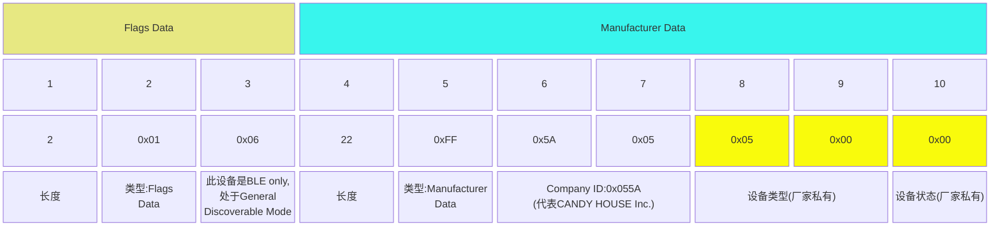
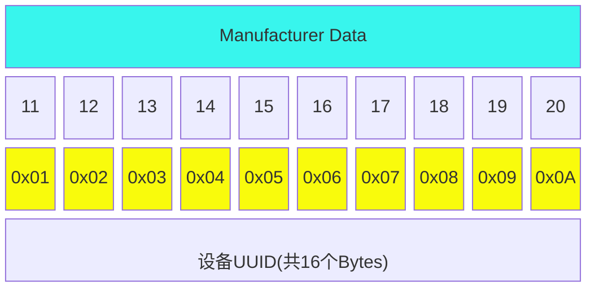
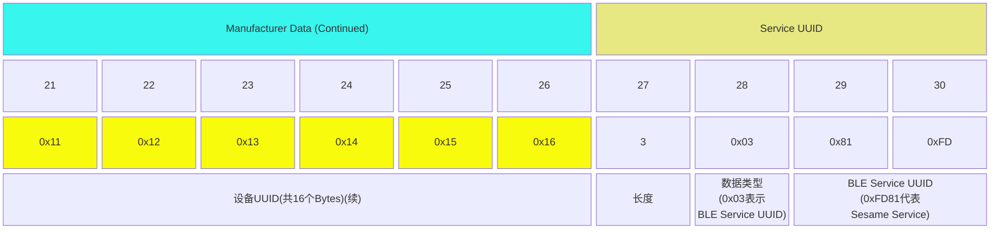

> 第一行：属于蓝牙规范，还是厂家定义
>
> 第二行：序号
>
> 第三行：十六进制值
>
> 第四行：内容描述


- Bluetooth LE 4.0 advertising 長度最長為 31 Bytes.
- <span style="background-color: #fdea8e;color:#000000">黃底</span>或<span style="background-color: #e4dc7f;color:#000000">黃底</span>標記表示 CANDY HOUSE 定義的協議。<br>
- 其餘白底皆是依 Bluetooth SIG 規範要求的義務宣告。<br>

### Bluetooth SIG 官方 IDs

- https://www.bluetooth.com/specifications/assigned-numbers/
- CANDY HOUSE 註冊於藍芽技術聯盟(Bluetooth SIG)的官方 Identifiers：

|                  | Decimal |  Hex   |
| :--------------: | :-----: | :----: |
| BLE Service UUID |  64897  | 0xFD81 |
|    Company ID    |  1370   | 0x055A |

### 機種 Product Model

- 藍芽廣播裡的第 8th 9th Bytes 表達機種

| 8th 9th Bytes |        機種        |
| :-----------: | :----------------: |
|       0       |      Sesame 3      |
|       1       |   WiFi Module 2    |
|       2       |    Sesame Bot 1    |
|       3       |   Sesame Bike 1    |
|       4       |      Sesame 4      |
|       5       |      Sesame 5      |
|       6       |   Sesame Bike 2    |
|       7       |    Sesame 5 Pro    |
|       8       |    Open Sensor     |
|       9       | Sesame Touch 1 Pro |
|      10       |   Sesame Touch 1   |
|      11       |   Ble Connector    |
|      13       |       Hub 3        |
|      14       |   Sesame Remote    |
|      15       |    Remote Nano     |
|      16       |    Sesame 5 Usa    |
|      17       |    Sesame Bot 2    |
|      18       |        F2          |
|      19       |        F1          |
|      20       |Bluetooth半導體光繼電器|

### 設備狀態 Device Status

- 藍芽廣播裡的第 10th Byte 切分成 8 個 bits, 每個 bit 表達設備的各種狀態
<table>
  <tbody>
    <tr>
      <td rowspan="2" style="text-align: center;">第10th Byte 的 8 個 bits</td>
      <td colspan="2" style="text-align: center;">設備狀態</td>
    </tr>
    <tr>
      <td style="text-align: center;">0</td>
      <td style="text-align: center;">1</td>
    </tr>
    <tr>
      <td style="text-align: center;">1st bit</td>
      <td style="text-align: center;">Unregistered</td>
      <td style="text-align: center;">Registered</td>
    </tr>
    <tr>
      <td style="text-align: center;">2nd bit</td>
      <td style="text-align: center;"></td>
      <td style="text-align: center;"></td>
    </tr>
    <tr>
      <td style="text-align: center;">3rd bit</td>
      <td style="text-align: center;"></td>
      <td style="text-align: center;"></td>
    </tr>
    <tr>
      <td style="text-align: center;">4th bit</td>
      <td style="text-align: center;"></td>
      <td style="text-align: center;"></td>
    </tr>
    <tr>
      <td style="text-align: center;">5th bit</td>
      <td style="text-align: center;"></td>
      <td style="text-align: center;"></td>
    </tr>
    <tr>
      <td style="text-align: center;">6th bit</td>
      <td style="text-align: center;"></td>
      <td style="text-align: center;"></td>
    </tr>
    <tr>
      <td style="text-align: center;">7th bit</td>
      <td style="text-align: center;"></td>
      <td style="text-align: center;"></td>
    </tr>
    <tr>
      <td style="text-align: center;">8th bit</td>
      <td style="text-align: center;"></td>
      <td style="text-align: center;"></td>
    </tr>
  </tbody>
</table>

#### 遵守  Accessory Design Guidelines for Apple Devices

- 49.2 Advertising Channels  
  The accessory should advertise on `all three advertising channels (37, 38, and 39)` at each advertising event. See the Bluetooth 4.0 specification, Volume 6, Part B, Section 4.4.2.1.
- https://developer.apple.com/accessories/Accessory-Design-Guidelines.pdf Release R21

#### 鼓勵用 nRF Connect app 熟悉 Sesame BLE adv

<p align="left"><a href="https://docs.google.com/drawings/d/1HXljFMZW53Rwn7eOhT03Sc2oP_C_Y6lPCpO2FyVkVmE/"></a></p>

- 推薦您使用 nRF Connect app 驗證並熟悉 Sesame BLE adv
- https://play.google.com/store/apps/details?id=no.nordicsemi.android.mcp
- https://apps.apple.com/app/id1054362403

<hr>

### 藍牙數據透傳(BLE Data Transmission)

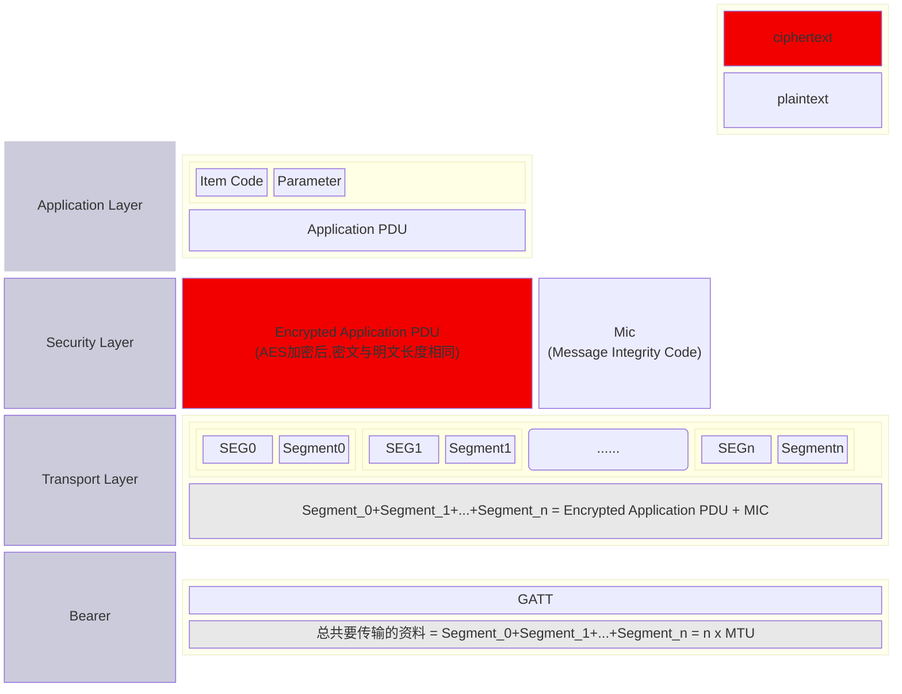
**单个SEG的定义:**

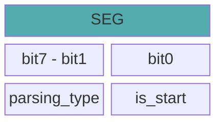
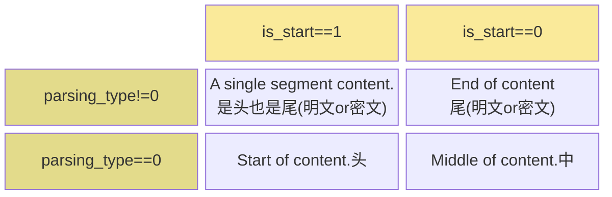


- 受到 TCP/IP 模型的啟發, 我們將藍芽通信分成 4 層。
- `明文的任意格式之信息` 經過 `加密`、`切割`後 `透過藍芽GATT收發`。4 個狀態分別稱 <u>Application Layer</u>, <u>Security Layer</u>, <u>Transport Layer</u>, <u>Gatt Bearer Layer</u>.
- 這套切割信息的作法, 可以傳輸無限長度的任意格式之信息。

### 傳輸協議 Request, Response and Publish

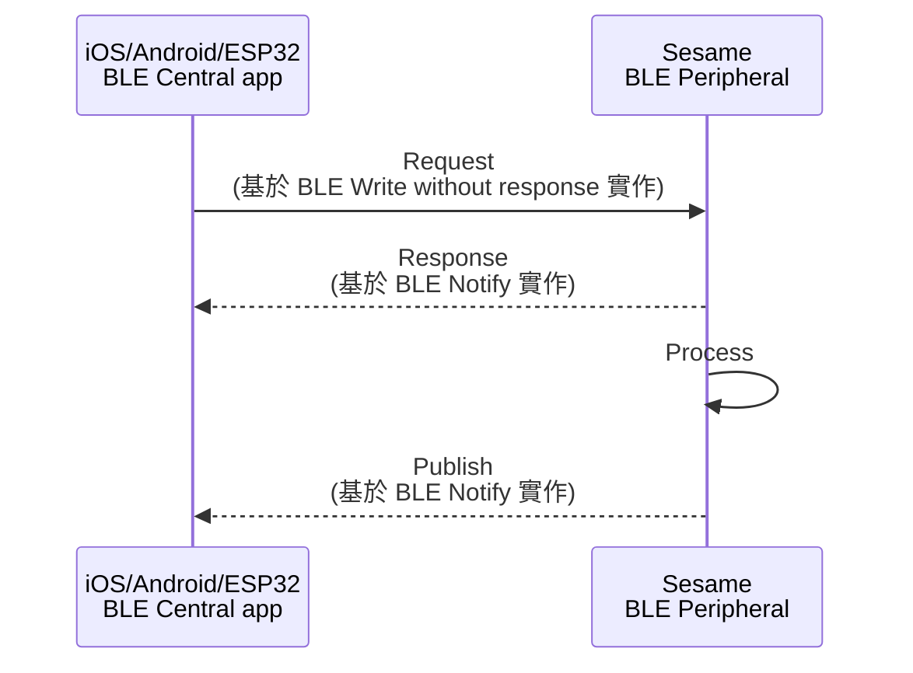

- 受到 RESTful API 增刪查改數據庫 POST 方法的啟發, 我們基於 `BLE write without response` 封裝了 1 命令方法：<br><span style="background-color: #fdea8e;color:#000000">・Request</span>
- 受到 RESTful API async/sync 的啟發, 我們基於`BLE notify`封裝成 2 個收 Callback 方法：<br><span style="background-color: #fdea8e;color:#000000">・Response</span><br><span style="background-color: #fdea8e;color:#000000">・Publish</span>
- `Response`方法與 <u>BLE write without `response`</u> 同名卻完全無關, 造成困擾我們十分抱歉。
- 每個 `Request` 都會立即得到一次 `Response`反饋。需要執行時間才能得知執行結果的信息以 `Publish`反饋。

### 只用到 2 個 BLE Characteristics 收發藍芽信息

- 透過 Request, Response, Publish 方法收發藍芽信息時, 只會用到 Sesame BLE Service(0xFD81) 的 2 個 BLE Characteristics.
- UUID 1686000<b>2</b>-a5ae-9856-b6d3-dbb4c676993e 的 Characteristics 是用來 write BLE commands without response
- UUID 1686000<b>3</b>-a5ae-9856-b6d3-dbb4c676993e 的 Characteristics 是用來 收 BLE Notify
<p align="left"><a href="https://docs.google.com/drawings/d/1E8PNgi7bTOfxj_APXK-yBPA2bjA4bNWQju8qv9Nx4SI/"></a></p>

## Application Layer 裡的業務內容

### 1. Sesame 「註冊」活動圖
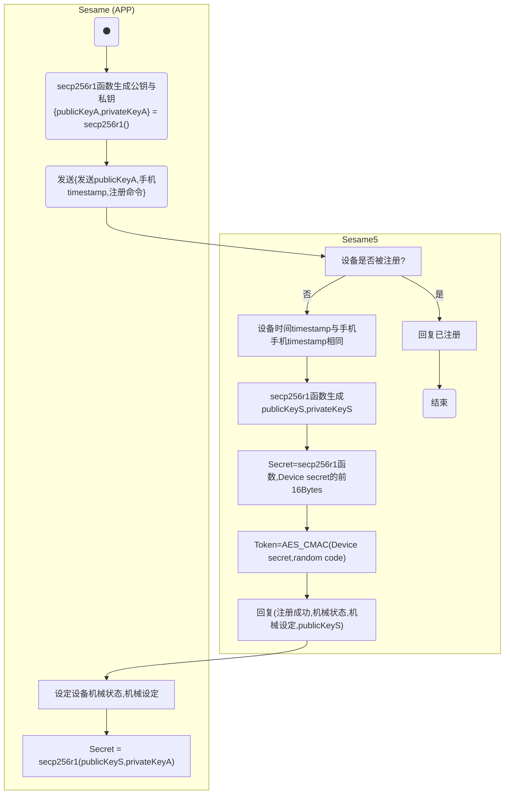


### 2. Sesame「註冊」循序圖

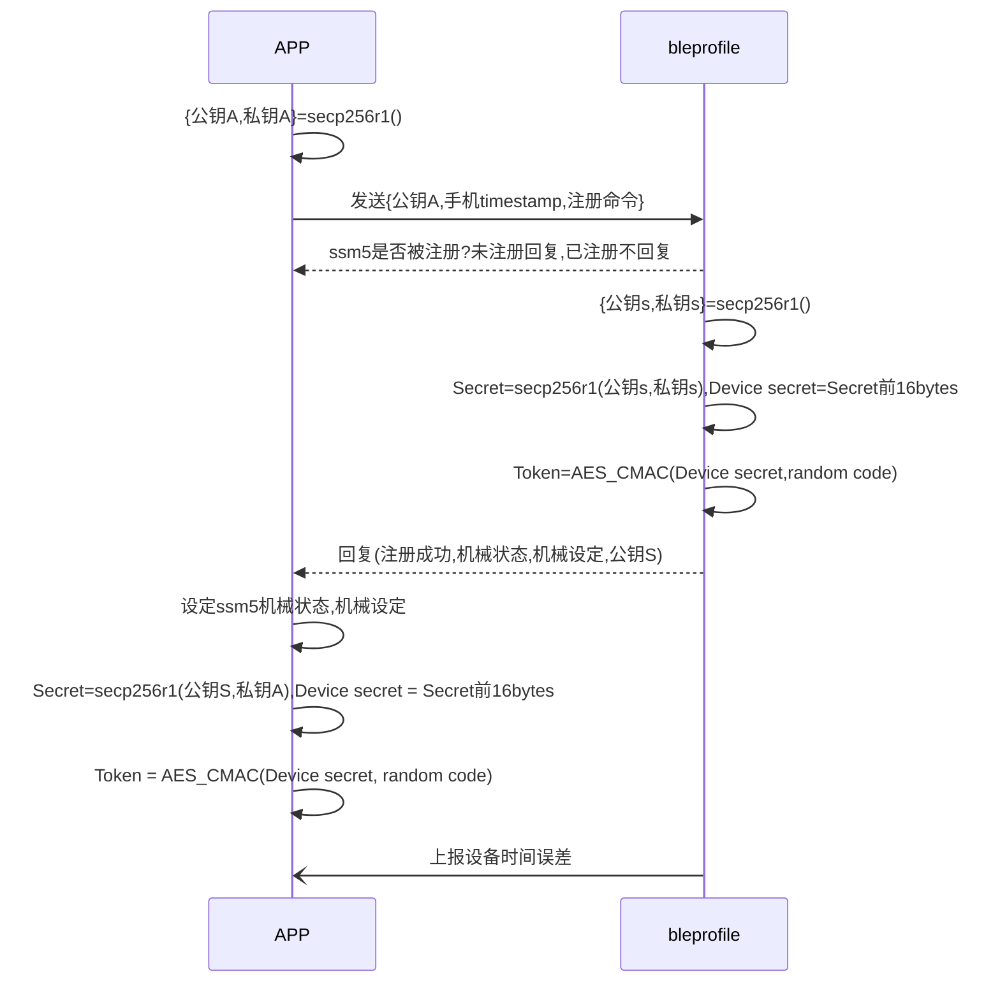


### 3. Sesame「登录」循序圖

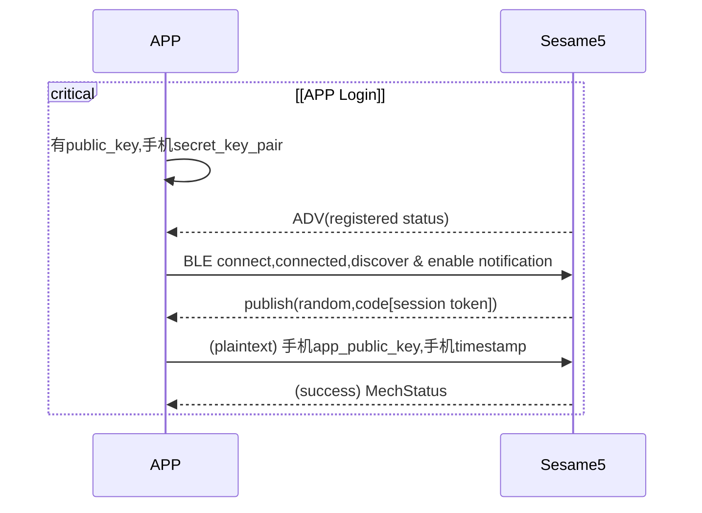


### 4. Sesame「发送命令」循序圖

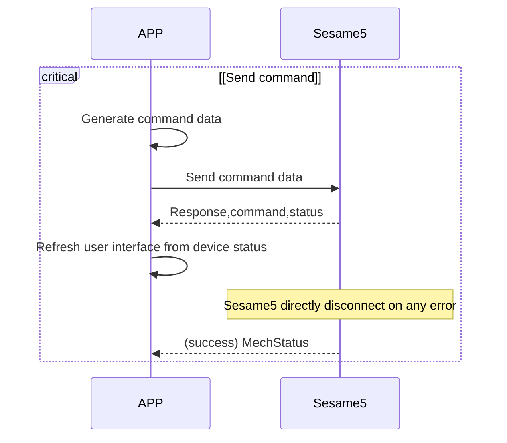


### 5. 對外封裝後的手機 SesameSDK 狀態機 State Machine

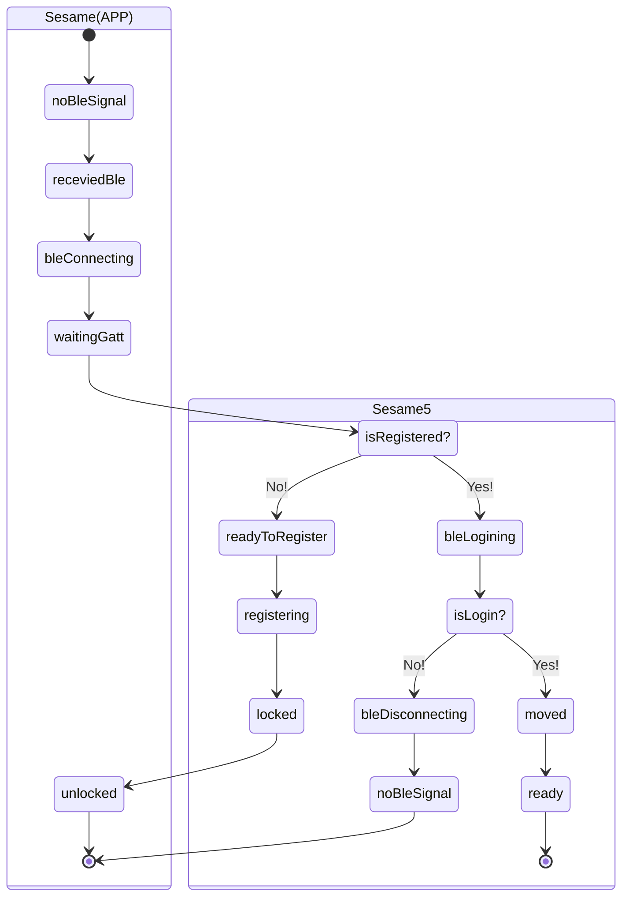


### 6. Sesame 時序圖

```mermaid
sequenceDiagram
autonumber
actor User
participant SesameApp
participant BleDevice

note over User,BleDevice: Preparation
alt BLE status == ON
    SesameApp->>SesameApp: Scan for Bluetooth devices
    SesameApp->>+BleDevice: Connect
    SesameApp->>SesameApp: Discover services
    SesameApp->>SesameApp: Discover characteristics
    SesameApp->>BleDevice: 5.Enable notifications
    BleDevice->>-SesameApp: 6.Initialization successful and a random code returned
    SesameApp->>SesameApp: 7.Save random code (session token)
    SesameApp->>SesameApp: 8.Generate key pair A
else BLE status != ON
	SesameApp->>SesameApp: Remind the user to turn on Bluetooth
end


note over User,BleDevice: Registration

User->>+SesameApp: Add device

par SesameS/Bike2/Open Sensor/Sesame Touch
	SesameApp->>SesameApp: Generate command data using public key of key pair A + timestamp
	SesameApp->>+BleDevice: Send command data
	BleDevice->>BleDevice: Synchronize time
	BleDevice->>BleDevice: Generate key pair B
	BleDevice->>BleDevice: Generate key with public key of key pair A and private key of key pair B
	BleDevice->>-SesameApp: Return status, settings, public key of key pair B
and WiFiModule2
    SesameApp->>SesameApp: Generate command data using public key of key pair A
    SesameApp->>+BleDevice: Send command data
    BleDevice->>BleDevice: Generate key pair B
    BleDevice->>BleDevice: Generate key with public key of key pair A and private key of key pair B
    BleDevice->>-SesameApp: Return public key of key pair B
    SesameApp->>SesameApp: Scan WiFi, set password, connect WiFi
end
SesameApp->>SesameApp: Generate key with private key of key pair A and public key of key pair B
SesameApp->>SesameApp: Update command encoder/decoder
SesameApp->>SesameApp: Insert device information with key
SesameApp->>SesameApp: Restore device state from shadow
SesameApp->>-User: Add device Result


Note over User,BleDevice: Login


par SesameS/Bike2/Open Sensor/Sesame Touch
    SesameApp->>SesameApp: Generate session authorization with signature
    SesameApp->>SesameApp: Without signature, generate session authorization with session token and key
    SesameApp->>SesameApp: Update command encoder/decoder
    
    SesameApp->>+BleDevice: Send command data
    BleDevice->>SesameApp: Verify key consistency
    BleDevice-->>-SesameApp: Return timestamp

    alt abs(device timestamp - app timestamp) >= 3
        SesameApp->>SesameApp: Get current time
        SesameApp->>BleDevice: Send command data
        BleDevice->>BleDevice: Synchronize time from App
    end
and WiFiModule2
    SesameApp->>SesameApp: Update command encoder/decoder
    SesameApp->>SesameApp: Generate command data with key and session token
    SesameApp->>BleDevice: Send command data
end
BleDevice-->>SesameApp: Response successful
BleDevice-->>SesameApp: Publish device status
SesameApp->>SesameApp: Respond with device status



Note over User,BleDevice: Send command
User->>SesameApp: Tap Sesame
par SesameS/Bike2/Open Sensor/Sesame Touch
	alt BLE connected
        SesameApp->>SesameApp: Generate command data
        SesameApp->>+BleDevice: Send command data
        BleDevice-->>-SesameApp: Publish device status
        SesameApp->>SesameApp: Restore interface from device status
    end
and WiFiModule2
    SesameApp->>SesameApp: Generate command data (key and public key when needed)
    SesameApp->>+BleDevice: Send command data
    BleDevice-->>-SesameApp: Publish device status
    SesameApp->>SesameApp: Restore interface from device status
end
SesameApp->>User: Return Result
```


## 手機藍牙跟 Sesame 兩種溝通方式

- 第一種是 <span style="background-color: #fdea8e;color:#000000">Publish</span>，Sesame 主動將訊息傳送給手機
- 第二種是 <span style="background-color: #fdea8e;color:#000000">Request</span>，手機要 Sesame 幹活，Sesame 回覆 <span style="background-color: #fdea8e;color:#000000">Response</span>應答

### 1. Publish【Sesame->手机】

当 NotifyEnable = `True` 的時候啓用，Sesame 主動將訂閱訊息推送給手機，如[「應答指令对照表」](#應答指令对照表) `81_機械狀態`。

| 字节索引 |    0     |     1     |     2 \~ N     |
| :------: | :------: | :-------: | :------------: |
|   Data   |   type   | item_code |    payload     |
|   說明   | 推送類型 | 指令編號  | 送給手機的資料 |

```c

typedef struct {
    uint8_t type;               /// 推送類型 : publish
    uint8_t item_code;          /// 指令 item_code
    union ss5_payload payload;  /// 送給手機的資料
} ss5_publish;

```

### 2. Request【手机->Sesame】

- `Request`即是手機要 Sesame 幹活，Sesame 回覆接收狀態，如[「請求指令對照表」](#請求指令對照表) `82_關鎖`
- 爲了避免混亂，需要一個保證順序的队列，支持同步串行发送，BLE 作為下位機的時候，就是讀寫各一個特徵值`Characteristics`，讀寫的操作方法是发送协议的內容

| 字节索引 |     0     |       1 ~ N        |
| :------: | :-------: | :----------------: |
|   Data   | item_code |      payload       |
|   說明   | 指令編號  | 送給 Sesame 的資料 |

```c

typedef struct {
    uint8_t item_code;              /// 指令(詳見 item_code)
    union ss5_payload payload;      /// 送給 Sesame5 的資料
} ss5_request;

```

```c
typedef enum {
    ITEM_CODE_NONE = 0,
    ITEM_CODE_REGISTRATION = 1,
    ITEM_CODE_LOGIN = 2,
    ITEM_CODE_HISTORY = 4,
    ITEM_CODE_VERSION_DETAIL = 5,
    ITEM_CODE_TIME = 8,
    ITEM_CODE_AUTOLOCK = 11,
    ITEM_CODE_INITIAL = 14,
    ITEM_CODE_IRER = 15,
    ITEM_CODE_MAGNET = 17,
    ITEM_CODE_MECH_SETTING = 80,
    ITEM_CODE_MECH_STATUS = 81,
    ITEM_CODE_LOCK = 82,
    ITEM_CODE_UNLOCK = 83,

	......
	
    SSM3_ITEM_RESET = 104
} item_code_e;
```

#### 2.1. Response 應答指令資料格式

| 字节索引 |    0     |     1     |      2       |     3 ～ N     |
| :------: | :------: | :-------: | :----------: | :------------: |
|   Data   |   type   | item_code |     res      |    payload     |
|   說明   | 推送類型 | 指令編號  | 命令處裡狀態 | 送給手機的資料 |

```c
typedef struct {
    uint8_t type;                   /// 推送類型:Response
    uint8_t item_code;              /// 指令(item_code)
    uint8_t res;                    /// 命令處理狀態 (都回 success)
    union ss5_payload payload;      /// 送給手機的資料
} ss5_response;

```

#### Result 處理狀態

```c
typedef enum {
    CMD_RESULT_SUCCESS = 0,         /// 手機发送命令给 Sesame5 會直接回 success
    CMD_RESULT_INVALID_ACTION = 9,  /// 已經註冊還下註冊命令
} cmd_result_e;
```

#### 2.2 Type 推送類型

標記符爲`0x07`時爲普通應答`response`，`0x08`爲主動推送`publish`

```c
typedef enum {
    OP_CODE_RESPONSE = 0x07,
    OP_CODE_PUBLISH = 0x08,
} op_code_e;
```

## 請求指令對照表

|                   字节索引                   |     0     |               1 ~ N                |              N+               |
| :------------------------------------------: | :-------: | :--------------------------------: | :---------------------------: |
|                     Data                     | item_code |              payload               |            others             |
|                     說明                     | 指令編號  |         送給 Sesame 的資料         |           其它資料            |
|           [注册](./1_registor.md)           |     1     |         1-64【publicKeyA】         |      65-68【timestamp】       |
|            [登入](./2_login.md)             |     2     |           1-4【ccmkeyA】           |
|           [历史](./4_history.md)            |     4     |            1【is peek】            |      ispeek=true 不删除       |
|        [版本](./5_version_detail.md)        |     5     |                none                |
|           [更新时间](./8_time.md)           |     8     |          1-4【timestamp】          |
|        [自动上锁](./11_autolock.md)         |    11     |            1-2【秒数】             |
|         [角度校正](./17_megnet.md)          |    17     |                none                |
|       [機械設定](./80_mechsetting.md)       |    80     |     1-5【autolock+开关锁角度】     |
|       [機械狀態](./81_mechstatus.md)        |    81     |                none                |          无响应             |
|            [關鎖](./82_lock.md)             |    82     |          1-7【历史标签】           |
|           [開鎖](./83_unlock.md)            |    83     |          1-7【历史标签】           |
|          [開門](./90_doorOpen.md)           |    90     |                none                |
|         [關門](./91_doorClosed.md)          |    91     |                none                |
|     [自動上鎖](./92_opsTimerSetting.md)     |    92     |                none                |
|           [重置](./104_reset.md)            |    104    |                none                |
|  [添加芝麻「touch」](./101_add_sesame.md)   |    101    |        1-16【Device Name】         |      17-32【secretKey】       |
| [删除芝麻「touch」](./103_remove_sesame.md) |    103    |        1-16【Device Name】         |
|  [更新卡片「touch」](./107_card_change.md)  |    107    | 0【Card ID Len】1-id_len【CardID】 | CardIDLen+1【CardNameLen】etc |
|  [删除卡片「touch」](./108_card_delete.md)  |    108    |          1-16【Card ID】           |
| [获取卡片「touch」](./113_card_mode_get.md) |    113    |                none                |
|     [卡片模式](./114_card_mode_set.md)      |    114    |                none                |
|     [指纹更新](./115_finger_change.md)      |    115    |          0【FingerIDLen】          |      1-Len【FingerID】】      |
|     [指纹删除](./116_finger_delete.md)      |    116    |           1【FingerID】            |
|       [指纹获取](./117_finger_get.md)       |    117    |                none                |
|    [指纹模式](./121_finger_mode_get.md)     |    121    |                none                |
|  [指纹模式设置](./122_finger_mode_set.md)   |    122    |                none                |
|       [密码更新](./123_pw_change.md)        |    123    |            0【PwIDlen】            |     1-pwLen【Password】】     |
|       [密码删除](./124_pw_delete.md)        |    124    |                none                |
|         [密码获取](./125_pw_get.md)         |    125    |                none                |
|    [获取密码模式](./129_pw_mode_get.md)     |    129    |                none                |
|    [密码模式设置](./130_pw_mode_set.md)     |    130    |           0 验证 1 新增            |

## 應答指令对照表

|                 字节索引                  |    0     |     1     |      2       |       3 ～ N       |          N+           |          N++           |
| :---------------------------------------: | :------: | :-------: | :----------: | :----------------: | :-------------------: | :--------------------: |
|                   Data                    |   type   | item_code |     res      |      payload       |        payload        |        payload         |
|                   說明                    | 推送類型 | 指令編號  | 命令處裡狀態 |  送給手機的資料 1  |   送給手機的資料 2    |    送給手機的資料 3    |
|         [初始化](./14_initial.md)         |    8     |    14     |      0       | 0-3【random code】 |         none          |
|         [注册](./1_registor.md)          |    7     |     1     |      0       | 0-6【mechStatus】  | 7-12【mechSetting】】 | 13~76【publicKeyS】】  |
|           [登入](./2_login.md)           |    7     |     2     |      0       |  0-3【timestamp】  |
|          [历史](./4_history.md)          |    7     |     4     |      0       |    0-3【id】】     |       4【type】       |    5-8【timestamp】    |
|      [版本](./5_version_detail.md)       |    7     |     5     |      0       |  0-11【version】   |
|     [機械設定](./80_mechsetting.md)      |    8     |    80     |      0       |    0-1【lock】     |    2-3【unlock】】    | 4-5【autolock_second】 |
|      [機械狀態](./81_mechstatus.md)      |    8     |    81     |      0       | 0-3【random code】 |
|   [推送芝麻钥匙](./102_pub_ssm_key.md)   |    8     |    102    |      0       | 0-21【ssm0-name】  |   22【ssm0-status】   | 23-44【ssm1_name】etc  |
|    [获取芝麻钥匙](./109_card_get.md)     |    7     |    109    |      0       |   0-3【CardID】    |
|     [获取指纹](./117_finger_get.md)      |    7     |    117    |      0       |  0-3【FingerID】   |
| [指纹模式获取](./121_finger_mode_get.md) |    8     |    121    |      0       | 0-3【random code】 |

## 安全层 Security Layer

安全層 Security Layer 是 手機藍牙 与 Sesame5 間資料透傳實作的加密傳輸協定。

### 1. 4 字节 Random code

搜尋到 芝麻設備的藍牙 並連線開啟特徵值爲`0xFD81`的`notify`，這時 芝麻設備 主動 `publish` 發送 4Bytes Random Code/Session Token。(詳見 `14_初始化`)

### 2. 设备密钥 Device secret

註冊時，APP 及 Sesame5 雙方都會透過 `secp256r1` 產生 `public key `及 `private key`，交換生成 `Device secret`。

- `publicKey` : 64 Bytes
- `privateKey` : 32 Bytes

secret : 32 Bytes

#### 步驟 :

- 1. sesame5 使用 `secp256r1` 產生 `publicKeyS` 及 `privateKeyS`
- 2. APP 使用 `secp256r1` 產生 `publicKeyA` 及 p`rivateKeyA`
- 3. 雙方交換 `publicKey`
- 4. sesame5 使用 `privateKeyS` 及 `publicKeyA` 產生 `secret S`
- 5. APP 使用 `privateKeyA` 及 `publicKeyS` 產生 `secret A`
- 6. `secret S` 跟 `secret A` 相等
- 7. 雙方將 secret 前 16 Bytes 作為 `Device secret`。

#### Token 用途

- 1. 登入驗證 (詳見 : `2_登入`)
- 2. 數據透傳時透過 `aes_ccm` 加密資料，使用 Token 作為加密時用到的 key。

#### 產生方式

以 AES_CMAC 演算法，使用 `Device secret` 對 4Bytes Random code 簽章，就能產生 `Token`。
`device_secret` :16 Bytes
`random_code` :4 Bytes
`Token` :16 Bytes

```c

AES_CMAC(key:device_secret, input:random_code, input_size:4, output:Token);

```

### 3. 資料加密与解密

#### 加密参数：初始化向量（`CCM_IV`）

- 1.  count :8 个字节，開機初始化為 0，每做一次加密 count 計數加一
- 2.  nouse :1 个字节 默认值為 0
- 3.  random_code :4 个字节，跟設備連線後更新 `random_code`

```c

typedef struct {
    int64_t count;///8 byte
    uint8_t nouse;///1 byte = 0
    uint8_t random_code[4];///4 byte
} CCM_IV;

```

#### aes_ccm 參數

輸入:

- 1.  key :加密密钥，用于 AES-CCM 操作
- 2.  iv :初始化向量（CCM_IV）
- 3.  iv length :AES-CCM 使用 13 字节（104 位）的 IV
- 4.  add :附加认证数据
- 5.  add length :附加认证数据长度
- 6.  input :要加密的输入数据
- 7.  input length :要加密的数据长度
- 8.  tag length :用于存储认证标签（MAC）的缓冲区和标签的长度

輸出:

- 1. tag : ccm_tag
- 2. output : ccm_ecrrypt_data 加密後的資料

#### C 語言 加密範例

```c
aes_ccm_encrypt_and_tag(
                        key:ccm_key,
                        iv:CCM_IV,
                        iv_length:13,
                        add:0x00,
                        add_length:1,
                        input:p_data,
                        add_length:length,
                        output:ccm_ecrrypt_data,
                        tag:ccm_tag,
                        tag_length:4
                        );
CCM_IV.count ++;
```

AES 爲對稱加密算法，方法名稱爲 `aes_ccm_auth_decrypt` 參數和加密相互對應

#### C 語言 解密範例

```c
aes_ccm_auth_decrypt(
                    key:ccm_key,
                    iv:CCM_IV,
                    iv_length:13,
                    add:0x00,
                    add_length:1,
                    input:ccm_ecrrypt_data,
                    add_length:length,
                    output:ans_data,
                    tag:ccm_tag, tag_length:4
                    );
CCM_IV.count ++;
```

::: info 注意
資料加解密使用的 CCM_IV 內有個 count 紀錄加密次數，若是加密與解密端的 count 計數不匹配會導致解密失敗。
:::

## Segment Layer

Segment Layer 要做兩件事情。

- 1. Sesame5 與 手機通訊時，限制封包最大長度 20Bytes，送長訊息需要對資料進行拆解，傳到接收端再組合。
- 2. 標記傳送的資料是否有加密，三種長度的明文密文封包方式。

### 1. 標記對照表

Segment Layer 在封包頭中的標記此封包是否被切割或加密，接收端可以按照標記做相應的處理，將封包還原成原始資料。以下為 Segment Layer 標記對照表。

Segment Layer 標記有 8bits，其中 bit 7 ~ 1 表示是否為結束封包及資料是否加密，bit 0 表示該封包是否為一筆資料的起始封包。

| bit 7 ~ 1 |   結束   | bit |  開始  |
| :-------: | :------: | :-: | :----: |
| b0000000  |  沒結束  |  0  | 非開始 |
| b0000000  |  沒結束  |  1  |  開始  |
| b0000001  | 明文結束 |  0  | 非開始 |
| b0000001  | 明文結束 |  1  |  開始  |
| b0000010  | 加密結束 |  0  | 非開始 |
| b0000010  | 加密結束 |  1  |  開始  |

#### 標記以 16 進位解讀

0 表示該封包不是開始封包也不是結束封包

1 表示該封包是開始封包不是結束封包

2 表示該封包不是開始封包是結束封包，並且組合起來的資料是明文

3 表示該封包是開始封包也是結束封包，並且資料是明文，資料沒有被切割，不需要組合

4 表示該封包不是開始封包是結束封包，並且組合起來的資料是密文

5 表示該封包是開始封包也是結束封包，並且資料是密文，資料沒有被切割，不需要組合

| 標記 |  開始  |   結束   |
| :--: | :----: | :------: |
| 0x00 | 非開始 |  沒結束  |
| 0x01 |  開始  |  沒結束  |
| 0x02 | 非開始 | 明文結束 |
| 0x03 |  開始  | 明文結束 |
| 0x04 | 非開始 | 加密結束 |
| 0x05 |  開始  | 加密結束 |

#### 範例

假設一個封包能放 4bytes 的資料，超過 4bytes 就需要進行分割(實際為 20bytes)。

### 2. 三種長度的明文密文封包方式

#### 2.1 短明文封包

資料: A A B B

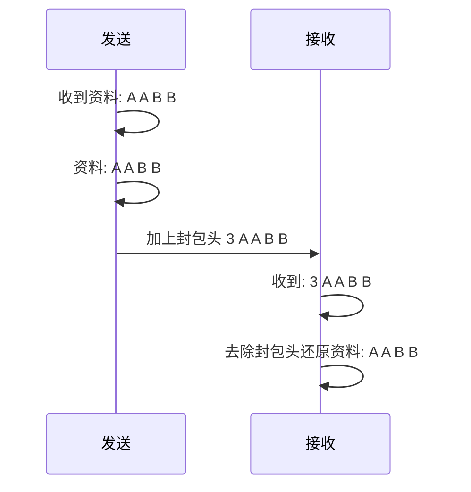

發送:

    1. 收到資料 : A A B B
    2. 資料 : A A B B
    3. 加上封包頭 : 3 A A B B

接收:

    4. 收到 : 3 A A B B
    5. 去除封包頭還原資料 : A A B B

#### 2.2 中明文封包

資料: A A A A B B B B

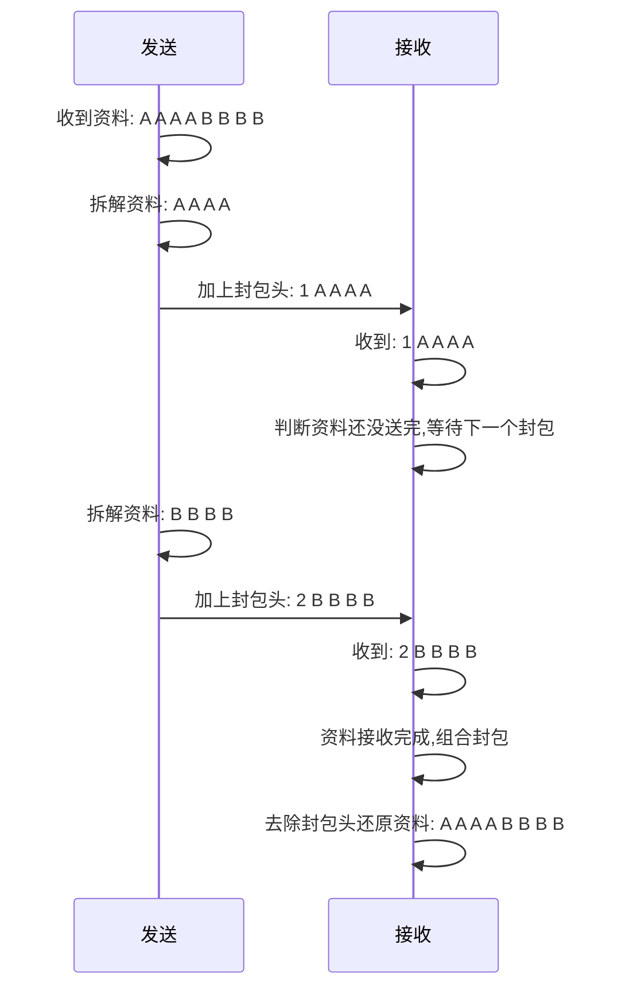


發送:

    1. 收到資料 : A A A A B B B B
    2. 拆解資料 : A A A A
    3. 加上封包頭 : 1 A A A A
    6. 拆解資料 : B B B B
    7. 加上封包頭 : 2 B B B B

接收:

    4. 收到 : 1 A A A A
    5. 判斷資料還沒送完，等下一個封包
    8. 收到 : 2 B B B B
    9. 資料接收完成，組合封包
    10. 去除封包頭還原資料 : A A A A B B B B

#### 2.3 長明文封包

資料 : A A A A B B B B C C C C
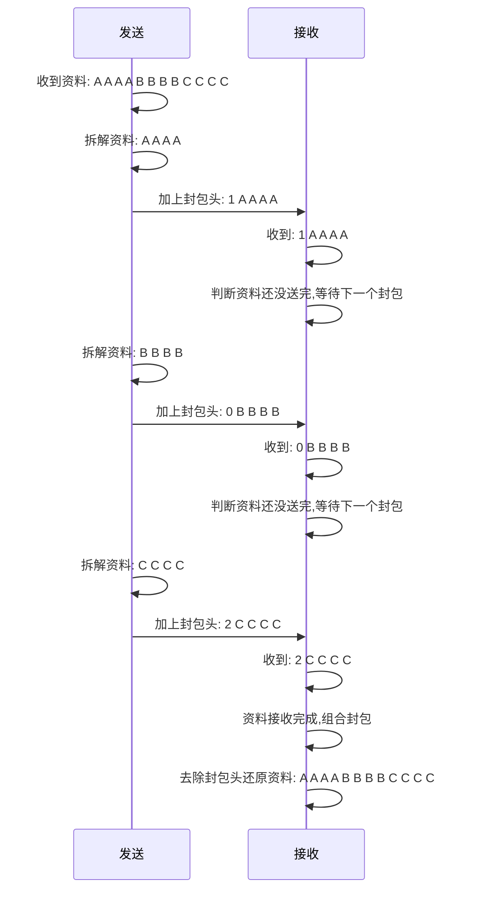


發送:

    1. 收到資料 : A A A A B B B B C C C C
    2. 拆解資料 : A A A A
    3. 加上封包頭 : 1 A A A A
    6. 拆解資料 : B B B B
    7. 加上封包頭 : 0 B B B B
    10. 拆解資料 : C C C C
    11. 加上封包頭 : 2 C C C C

接收:

    4. 收到 : 1 A A A A
    5. 判斷資料還沒送完，等下一個封包
    8. 收到 : 0 B B B B
    9. 判斷資料還沒送完，等下一個封包
    12. 收到 : 2 C C C C
    13. 資料接收完成，組合封包
    14. 去除封包頭還原資料 : A A A A B B B B C C C C

#### 2.4 短密文封包

資料 : A A B B

資料加密後 : X X Y Y


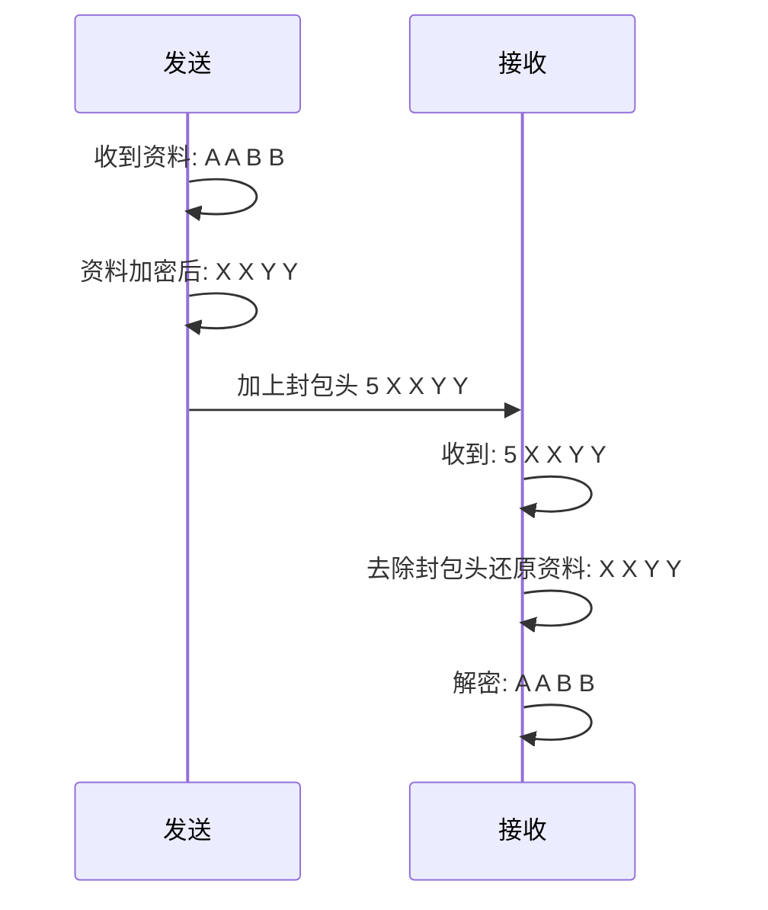


發送:

    1. 收到資料 : A A B B
    2. 資料加密後 : X X Y Y
    3. 加上封包頭 : 5 X X Y Y

接收:

    4. 收到 : 5 X X Y Y
    5. 去除封包頭還原資料 : X X Y Y
    6. 解密 : A A B B

#### 2.5 中密文封包

資料: A A A A B B B B

資料加密後 : X X X X Y Y Y Y


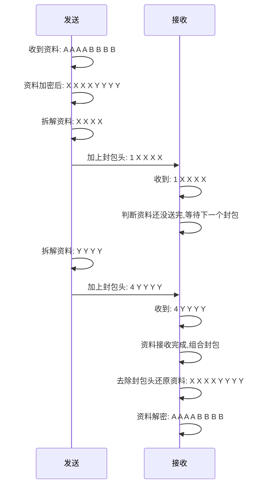


發送:

    1. 收到資料 : A A A A B B B B
    2. 資料加密後 : X X X X Y Y Y Y
    3. 拆解資料 : X X X X
    4. 加上封包頭 : 1 X X X X
    7. 拆解資料 : Y Y Y Y
    8. 加上封包頭 : 4 Y Y Y Y

接收:

    5. 收到 : 1 X X X X
    6. 判斷資料還沒送完，等下一個封包
    9. 收到 : 4 Y Y Y Y
    10. 資料接收完成，組合封包
    11. 去除封包頭還原資料 : X X X X Y Y Y Y
    12. 資料解密 : A A A A B B B B

#### 2.6 長密文封包

資料 : A A A A B B B B C C C C

資料加密後 : X X X X Y Y Y Y Z Z Z Z


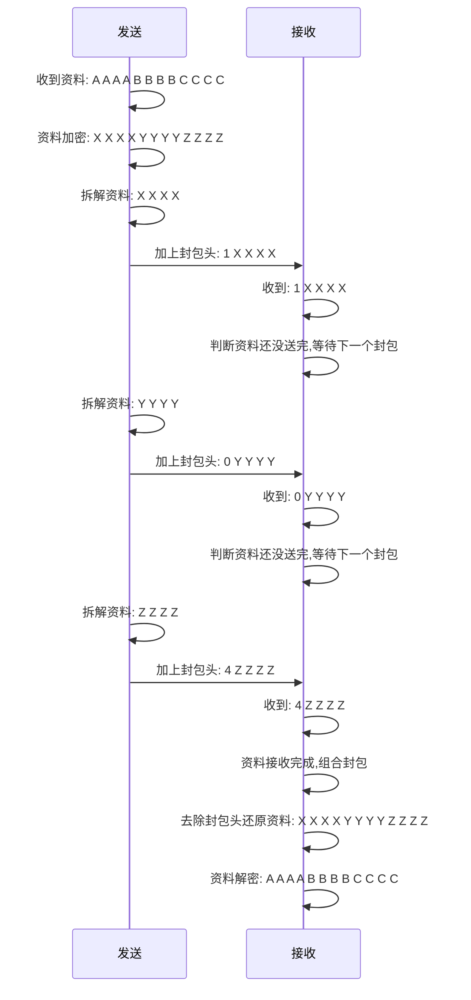


發送:

    1. 收到資料 : A A A A B B B B C C C C
    2. 資料加密後 : X X X X Y Y Y Y Z Z Z Z
    3. 拆解資料 : X X X X
    4. 加上封包頭 : 1 X X X X
    7. 拆解資料 : Y Y Y Y
    8. 加上封包頭 : 0 Y Y Y Y
    11. 拆解資料 : Z Z Z Z
    12. 加上封包頭 : 4 Z Z Z Z

接收:

    5. 收到 : 1 X X X X
    6. 判斷資料還沒送完，等下一個封包
    9. 收到 : 0 Y Y Y Y
    10. 判斷資料還沒送完，等下一個封包
    13. 收到 : 4 Z Z Z Z
    14. 資料接收完成，組合封包
    15. 去除封包頭還原資料 : X X X X Y Y Y Y Z Z Z Z
    16. 資料解密 : A A A A B B B B C C C C

::: info 注意
資料經過 AES_CCM 加密後除了密文外還會產生 4Bytes 的 ccm_tag 用於解密，密文及 ccm_tag 需要一起傳給接收端，因此加密後的資料會增加 4Bytes，詳見 `security_Layer` 說明。
:::

