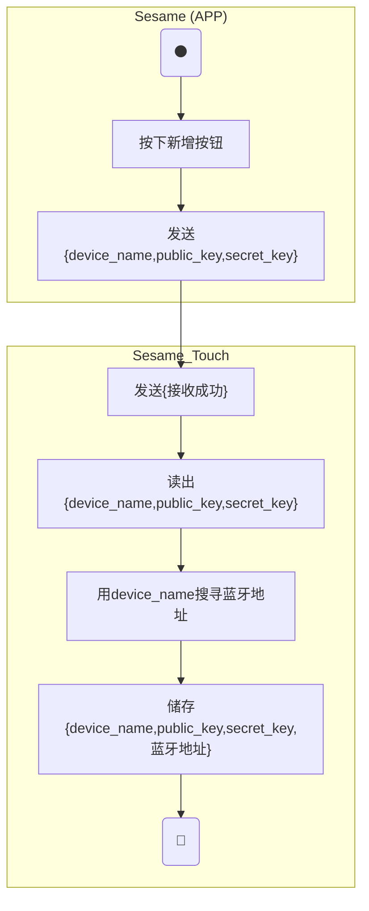
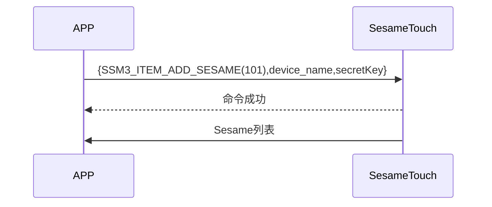

# 101 Add Sesame (Add)

The phone sends a command and Token to add, sesame5 replies the command is successful, and ssm_touch actively pushes the Sesame list to the phone. (For details of the Sesame list, see `102_pub_ssm_key`)

## Activity Diagram (Add Sesame4)

The Bluetooth address of Sesame4 cannot be parsed from the sent information, so it needs to scan the surrounding Bluetooth devices to find the Bluetooth address of Sesame4.

## Activity Diagram (Add Sesame5)

The Bluetooth address of Sesame5 can be parsed from the sent information, so there's no need to scan the surrounding Bluetooth devices.

sessionKey = AES_CMAC(key:device_name, input:"candy")

address = sessionKey[0~5]

address[5] |= 0xC0

## Sequence Diagram

## Phone Sends Out Data

| Byte |  32 ~ 17  |   16 ~ 1    |     0     |
| ---- | :-------: | :---------: | :-------: |
| Data | secretKey | device_name | item code |

item code : SSM3_ITEM_ADD_SESAME (101)

## ssm_touch Return Content

| Byte |      2       |     1     |    0     |
| ---- | :----------: | :-------: | :------: |
| Data |     res      | item_code |   type   |
| Description | Command processing status | Command number  | Push type |

type : SSM2_OP_CODE_RESPONSE (0x07)

item code : SSM3_ITEM_ADD_SESAME (101)

res : CMD_RESULT_SUCCESS (0x00)

## iOS, Android, ESP32 Examples

