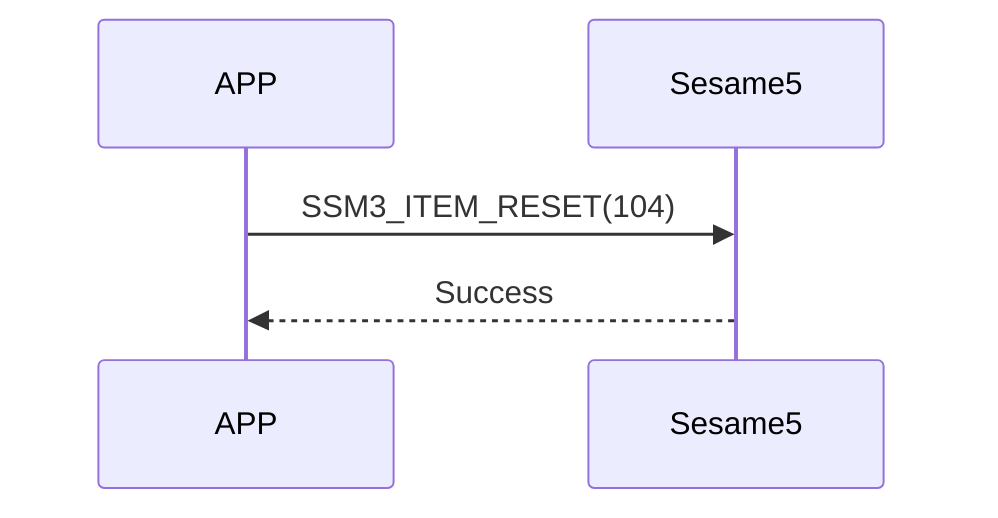

# 104. Reset (reset)

The mobile phone sends a reset command, sesame5 replies that the command is successful, and clears the data and restarts.

## Sequence chart



## Mobile phones send data

| Byte |     0     |
| ---- | :-------: |
| Data | item code |

item code: SSM3_ITEM_RESET (104)

## ssm5 returns content

| Byte |      2       |     1     |    0     |
| ---- | :----------: | :-------: | :------: |
| Data |     res      | item_code |   type   |
| Explanation | Command processing status | command number  | push type |

type: SSM2_OP_CODE_RESPONSE (0x07)

item code: SSM3_ITEM_RESET (104)

res: CMD_RESULT_SUCCESS (0x00)

## iOS, Android, ESP32 examples

### Android Example

```kotlin
open fun reset(result: CHResult<CHEmpty>) {
      sendCommand(SesameOS3Payload(SesameItemCode.Reset.value, byteArrayOf()), DeviceSegmentType.cipher) { res ->
          if (res.cmdResultCode == SesameResultCode.success.value) {
              dropKey(result)
          } else {
              result.invoke(Result.failure(NSError(res.cmdResultCode.toString(), "CBCentralManager", res.cmdResultCode.toInt())))
          }
      }
  }
```

### iOS Example

```swift
    func reset(result: @escaping (CHResult<CHEmpty>)) {
      if (self.checkBle(result)) { return }
      sendCommand(.init(.reset)) { (responsePayload) in
              self.dropKey { dropResult in
                  switch dropResult {
                  case .success(_):
                      result(.success(CHResultStateNetworks(input: CHEmpty())))
                  case .failure(let error):
                      result(.failure(error))
                  }
              }
          }
      }
```

### ESP Example

```c
if (src_id == SSM3_ITEM_RESET) {
      talk_to_mob(p_param->conidx, SSM2_SEG_PARSING_TYPE_CIPHERTEXT, ble_tx_buf, 3);
      static co_timer_t reset_timer;
      co_timer_set(&reset_timer, 1000, TIMER_ONE_SHOT, after_100ms_reboot, NULL);
  }
```
