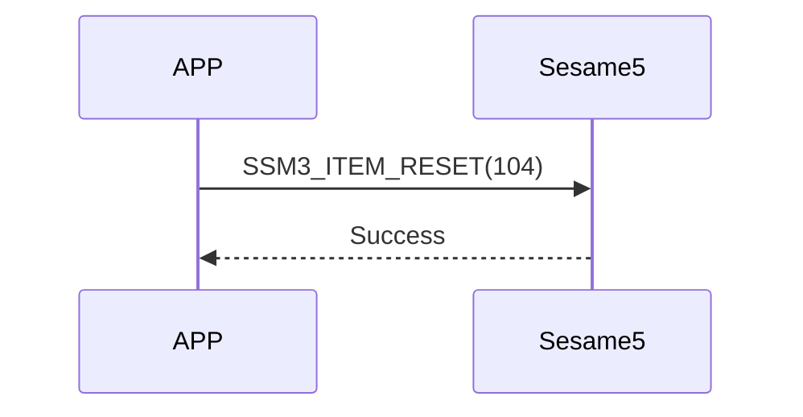

# 104 Reset (reset)

The mobile phone sends a reset command, sesame5 replies that the command is successful, and clears the data and restarts.

## Sequence chart

## Mobile phones send data

| Byte |     0     |
| ---- | :-------: |
| Data | item code |

item code: SSM3_ITEM_RESET (104)

## ssm5 returns content

| Byte |      2       |     1     |    0     |
| ---- | :----------: | :-------: | :------: |
| Data |     res      | item_code |   type   |
| Explanation | Command processing status | command number  | push type |

type: SSM2_OP_CODE_RESPONSE (0x07)

item code: SSM3_ITEM_RESET (104)

res: CMD_RESULT_SUCCESS (0x00)

## iOS, Android, ESP32 examples

