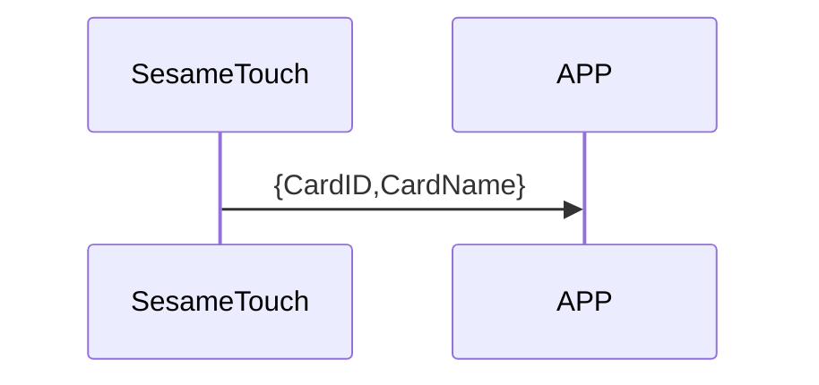

# 110 Card Notify (Push Card)

ssm_touch actively pushes card information to mobile phone.

## Sequence diagram



## ssm_touch push content

| Byte |     N ~ 2      |     1     |    0     |
| ---- | :------------: | :-------: | :------: |
| Data |    payload     | item_code |   type   |
| Explanation | Data sent to the phone |Command number | Push type |

type : SSM2_OP_CODE_PUBLISH (0x08)

item code : SSM2_ITEM_CODE_INITIAL (102)

payload : See the table below for details

### payload

| Byte | (Card ID Len + Card Name Len + 2) ~ (Card ID Len + 3) | Card ID Len + 2 | (Card ID Len + 1) ~ 2 |      1      |     0     |
| :--: | :---------------------------------------------------: | :-------------: | :-------------------: | :---------: | :-------: |
| Data |                       card_name                       |  card_name_len  |        card_id        | card_id_len | card_type |

#### Example

card_id_len = 7

card_name_len = 8

| Byte |  17 ~ 10  |       9       |  8 ~ 2  |      1      |     0     |
| :--: | :-------: | :-----------: | :-----: | :---------: | :-------: |
| Data | card_name | card_name_len | card_id | card_id_len | card_type |

## iOS, Android, ESP32 examples
 ## Android Example

```jsx | pure
if (receivePayload.cmdItCode == SesameItemCode.SSM_OS3_CARD_NOTIFY.value) {
            val card = CHSesameTouchCard(receivePayload.payload)
            (delegate as? CHSesameTouchProDelegate)?.onCardReceive(this, card.cardID, card.cardName, card.cardType)
}
```

## iOS Example

```jsx | pure
    case .SSM_OS3_CARD_NOTIFY:
        let card = CHSesameTouchCard(data:data)
        (self.delegate as? CHSesameTouchProDelegate)?.onCardReceive(device:self, id: card.cardID, name: card.cardName, type: card.cardType)
```

Discontinued 