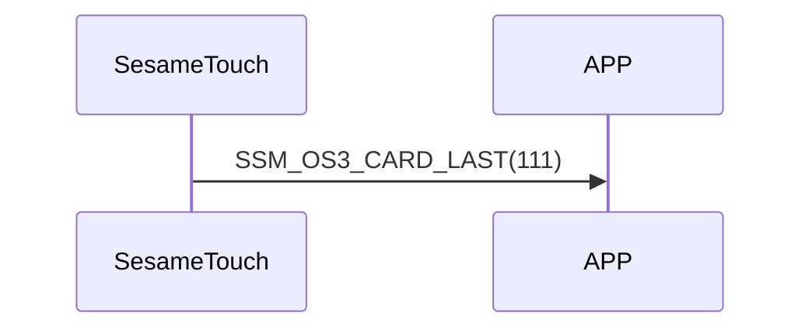

# 111. Card Last

After ssm_touch finishes sending card data, it sends Card Last to the phone to indicate that all card data has been sent.

## Sequence diagram

## ssm_touch push content
| Byte | 1         | 0    |
|-------|:---------:|:----:|
| Data  | item_code | type |
| Description | Item code | Type |

type : SSM2_OP_CODE_PUBLISH (0x08)

item code : SSM_OS3_CARD_LAST (111)
