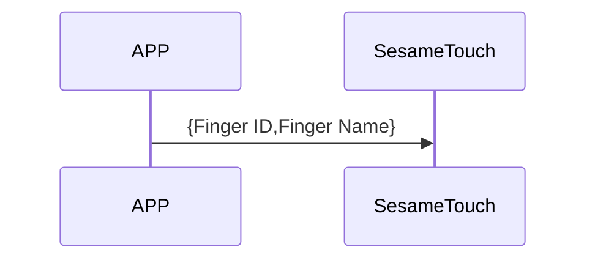
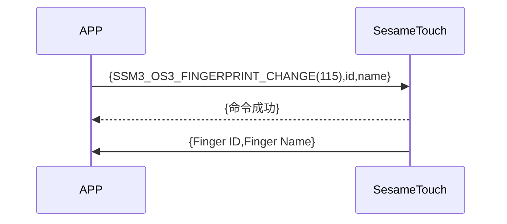

# 115. Finger Change (Fingerprint Update)

1. ssm_touch adds a new fingerprint and proactively pushes the new fingerprint ID and name to the phone.
2. The mobile phone sends the id and new name to ssm_touch. After ssm_touch returns the command received successfully, it modifies the fingerprint name and proactively pushes the new fingerprint ID and name to the mobile phone (names longer than 20 Bytes, only the first 20 Bytes are taken).

## Sequence Diagram (Adding Fingerprint)



## Sequence Diagram (Editing Fingerprint Name)



## Mobile Sends Out Data

| Byte |  N ~ 1  |     0     |
| ---- | :-----: | :-------: |
| Data | payload | item code |

item code : SSM_OS3_FINGERPRINT_CHANGE (115)

payload : see the table below

### payload

| Byte | (Finger Name Len + Finger ID Len + 1) ~ (Finger ID Len + 2) | Finger ID Len + 1 | Finger ID Len ~ 1 |       0       |
| :--: | :---------------------------------------------------------: | :---------------: | :---------------: | :-----------: |
| Data |                         Finger Name                         |  Finger Name Len  |     Finger ID     | Finger ID Len |

#### Example

id_len = 5

name_len = 4

| Byte |   10 ~ 7    |        6        |   5 ~ 1   |       0       |
| :--: | :---------: | :-------------: | :-------: | :-----------: |
| Data | Finger Name | Finger Name Len | Finger ID | Finger ID Len |

## ssm_touch Returns Content

| Byte |      2       |     1     |    0     |
| ---- | :----------: | :-------: | :------: |
| Data |     res      | item_code |   type   |
| Explanation | Command processing state | Instruction number  | Push Type |

type : SSM2_OP_CODE_RESPONSE (0x07)

item code : SSM_OS3_FINGERPRINT_CHANGE (115)

res : CMD_RESULT_SUCCESS (0x00)

## ssm_touch Pushes Content

| Byte |     N ~ 2      |     1     |    0     |
| ---- | :------------: | :-------: | :------: |
| Data |    payload     | item_code |   type   |
| Explanation | Data sent to the phone | Instruction number  | Push Type |

type : SSM2_OP_CODE_PUBLISH (0x08)

item code : SSM_OS3_FINGERPRINT_CHANGE (115)

payload : see the table below

### payload

| Byte | (Finger Name Len + Finger ID Len + 1) ~ (Finger ID Len + 2) | Finger ID Len + 1 | Finger ID Len ~ 1 |       0       |
| :--: | :---------------------------------------------------------: | :---------------: | :---------------: | :-----------: |
| Data |                         Finger Name                         |  Finger Name Len  |     Finger ID     | Finger ID Len |

#### Example

id_len = 5

name_len = 4

| Byte |   10 ~ 7    |        6        |   5 ~ 1   |       0       |
| :--: | :---------: | :-------------: | :-------: | :-----------: |
| Data | Finger Name | Finger Name Len | Finger ID | Finger ID Len |

## iOS, Android, ESP32 Example

### Android Example

```kotlin
    override fun fingerPrintsChange(ID: String, name: String, result: CHResult<CHEmpty>) {
      if (checkBle(result)) return
      sendCommand(SesameOS3Payload(SesameItemCode.SSM_OS3_FINGERPRINT_CHANGE.value, byteArrayOf(ID.hexStringToByteArray().size.toByte()) + ID.hexStringToByteArray() + name.toByteArray())) { res ->
          result.invoke(Result.success(CHResultState.CHResultStateBLE(CHEmpty())))
      }
  }
```

### iOS Example

```swift
    func fingerPrintsChange(ID: String, name: String, result: @escaping (CHResult<CHEmpty>) ) { //改名稱
      if (self.checkBle(result)) { return }

      let idData = ID.hexStringtoData()
      L.d("idData???=>", idData)
      let payload = Data([UInt8(idData.count)]) + idData + name.bytes
      L.d("TouchDevice payload =>",payload.toHexLog())
      sendCommand(.init(.SSM_OS3_FINGERPRINT_CHANGE, payload)) { _ in
          L.d("[TouchDevice][fingerPrintsChange][ok]")
          result(.success(CHResultStateNetworks(input: CHEmpty())))
      }
  }
```
