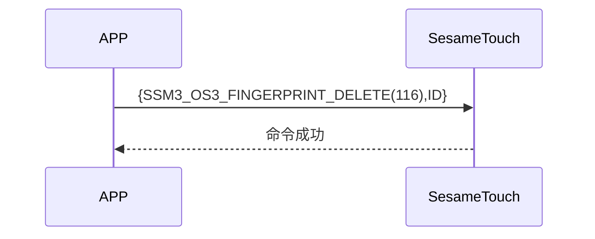

# 116 Finger Delete (Fingerprint Deletion)

The mobile terminal sends the fingerprint ID to be deleted, ssm_touch returns a successful message, deleting the designated fingerprint.

## Sequence Diagram

## Data sent by the Mobile

| Byte |     1     |     0     |
| ---- | :-------: | :-------: |
| Data | finger_id | item code |

item code : SSM_OS3_FINGERPRINT_DELETE (116)

finger_id : The fingerprint ID to be deleted

## The contents returned by ssm_touch

| Byte |      2       |     1     |    0     |
| ---- | :----------: | :-------: | :------: |
| Data |     res      | item_code |   type   |
| Description | Command processing status | Instruction number  | Push type |

type : SSM2_OP_CODE_RESPONSE (0x07)

item code : SSM_OS3_FINGERPRINT_DELETE (116)

res : CMD_RESULT_SUCCESS (0x00)

## iOS, Android, ESP32 Examples

