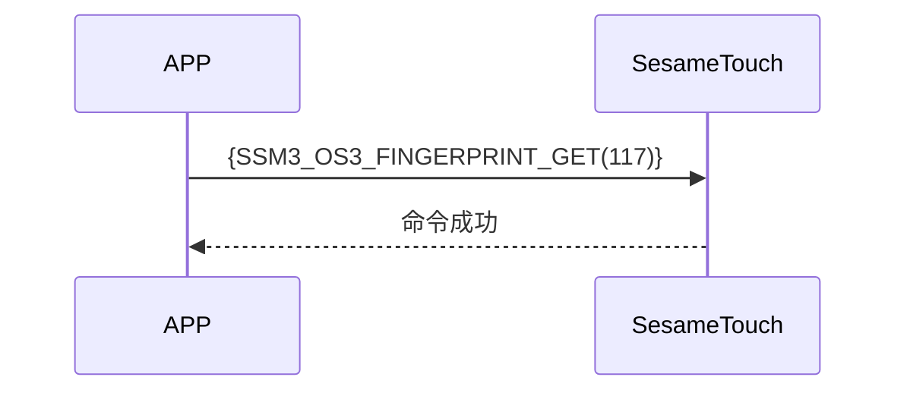

# 117 Finger Get (Fingerprint Acquisition)

The phone sends a command to get fingerprints to ssm_touch, ssm_touch responds with a successful command, and will then send fingerprint data to the phone.

## Sequence Diagram



## Phone Sending Data

| Byte |     0     |
| ---- | :-------: |
| Data | item code |

item code : SSM_OS3_FINGERPRINT_GET (117)

## ssm_touch Response Content

| Byte |      2       |     1     |    0     |
| ---- | :----------: | :-------: | :------: |
| Data |     res      | item_code |   type   |
| Explanation | Command processing status | Command number  | Push type |

type : SSM2_OP_CODE_RESPONSE (0x07)

item code : SSM_OS3_FINGERPRINT_GET (117)

res : CMD_RESULT_SUCCESS (0x00)

## iOS, Android, ESP32 Examples
 ## Android Example

```jsx | pure
    override fun fingerPrints(result: CHResult<CHEmpty>) {
        if (checkBle(result)) return
        sendCommand(SesameOS3Payload(SesameItemCode.SSM_OS3_FINGERPRINT_GET.value, byteArrayOf())) { res ->
            result.invoke(Result.success(CHResultState.CHResultStateBLE(CHEmpty())))
        }
    }
```

## iOS Example

```jsx | pure
    func fingerPrints( result: @escaping (CHResult<CHEmpty>)) {
        if (self.checkBle(result)) { return }
        sendCommand(.init(.SSM_OS3_FINGERPRINT_GET)) { _ in
            result(.success(CHResultStateNetworks(input: CHEmpty())))
        }
    }
```

## ESP Example

```jsx | pure

``` 