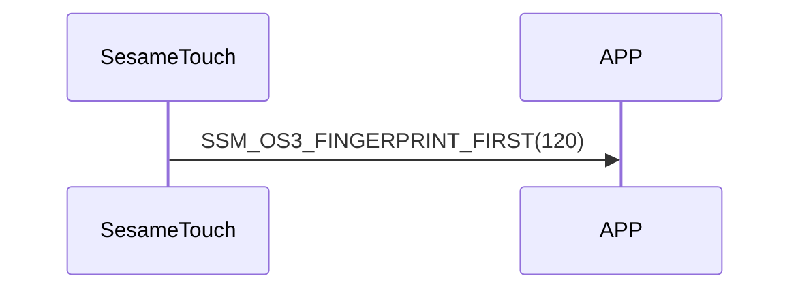

# 120. Finger Start

After receiving `117_finger_get`, ssm_touch sends the Finger Start command to indicate that it is about to start sending fingerprint data to the phone (see `118_finger_notify`).

## Sequence diagram

## ssm_touch push content
| Byte | 1         | 0    |
|-------|:---------:|:----:|
| Data  | item_code | type |
| Description | Item code | Type |

type : SSM2_OP_CODE_PUBLISH (0x08)

item code : SSM_OS3_FINGERPRINT_FIRST (120)