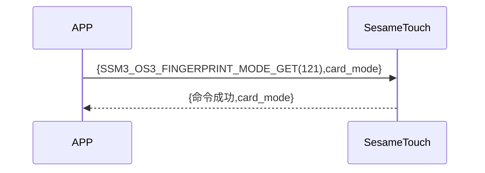

# 121 Finger Mode Get (Fingerprint Mode)

The mobile phone sends a new command to get ssm_touch currently in the new or fingerprint verification mode, and sesame5 replies successfully and mode.

## Sequence diagram



## Mobile phone sends data

| Byte |     0     |
| ---- | :-------: |
| Data | item code |

item code : SSM_OS3_FINGERPRINT_MODE_GET (121)

## ssm_touch returns content

| Byte |      4      |  3  |     2     |  1   |    0    |
| ---- | :---------: | :-: | :-------: | :--: | :-----: |
| Data | finger mode | res | item code | type | op code |

type : SSM2_OP_CODE_RESPONSE(0x07)

item code : SSM_OS3_FINGERPRINT_MODE_GET (121)

res : CMD_RESULT_SUCCESS (0x00)

### finger mode

0x00 -> Verification mode

0x01 -> New mode

## iOS, Android, ESP32 examples
 ## Android example

```jsx | pure
    override fun fingerPrintModeGet(result: CHResult<Byte>) {
        if (checkBle(result)) return
        sendCommand(SesameOS3Payload(SesameItemCode.SSM_OS3_FINGERPRINT_MODE_GET.value, byteArrayOf())) { res ->
            result.invoke(Result.success(CHResultState.CHResultStateBLE(res.payload[0])))
        }
    }
```

## iOS example

```jsx | pure
    func fingerPrintModeGet(result: @escaping (CHResult<UInt8>)) {
        if (self.checkBle(result)) { return }

        sendCommand(.init(.SSM_OS3_FINGERPRINT_MODE_GET)) { response in
            L.d("[TouchDevice][fingerPrintModeGet]",response.data[0])
            result(.success(CHResultStateNetworks(input: response.data[0])))
        }
    }
```

## ESP example

```jsx | pure

``` 