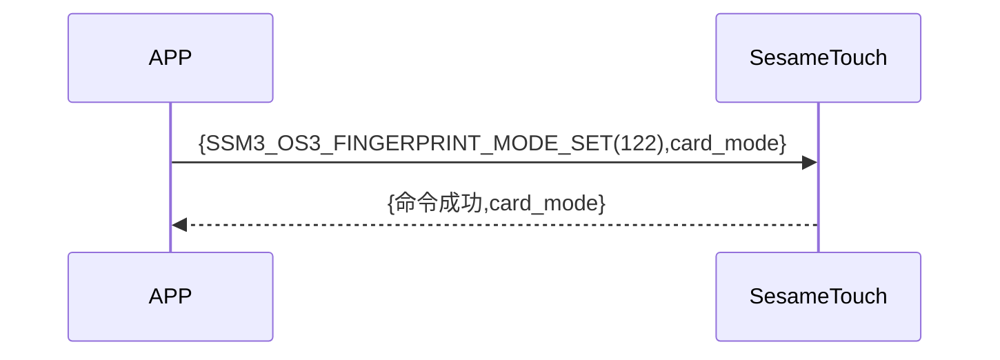

# 122. Finger Mode Set (Fingerprint Mode Settings)

The phone sends an addition command to get whether ssm_touch is now in addition or fingerprint mode, sesame5 replies the command successfully and the mode.

## Sequence diagram



## Data sent by the phone

 | Byte |      1      |     0     |
 | ---- | :---------: | :-------: |
 | Data | finger_mode | item code |

item code : SSM_OS3_CARD_MODE_SET (114)

## ssm_touch returned content

| Byte |      4      |  3  |     2     |  1   |    0    |
| ---- | :---------: | :-: | :-------: | :--: | :-----: |
| Data | finger mode | res | item code | type | op code |

type : SSM2_OP_CODE_RESPONSE(0x07)

item code : SSM_OS3_CARD_MODE_SET (114)

res : CMD_RESULT_SUCCESS (0x00)

## finger mode

0x00->Verification Mode

0x01->Addition Mode

## iOS, Android, ESP32 examples
 ## Android example

```jsx | pure
   override fun fingerPrintModeSet(mode: Byte, result: CHResult<CHEmpty>) {
        if (checkBle(result)) return
        sendCommand(SesameOS3Payload(SesameItemCode.SSM_OS3_FINGERPRINT_MODE_SET.value, byteArrayOf(mode))) {
            result.invoke(Result.success(CHResultState.CHResultStateBLE(CHEmpty())))
        }
    }
```

## iOS example

```jsx | pure
    func fingerPrintModeSet(mode: UInt8, result: @escaping (CHResult<CHEmpty>)) {
        if (self.checkBle(result)) { return }

        sendCommand(.init(.SSM_OS3_FINGERPRINT_MODE_SET,Data([mode]))) { _ in
            result(.success(CHResultStateNetworks(input: CHEmpty())))
        }
    }
```

## ESP example

```jsx | pure

``` 