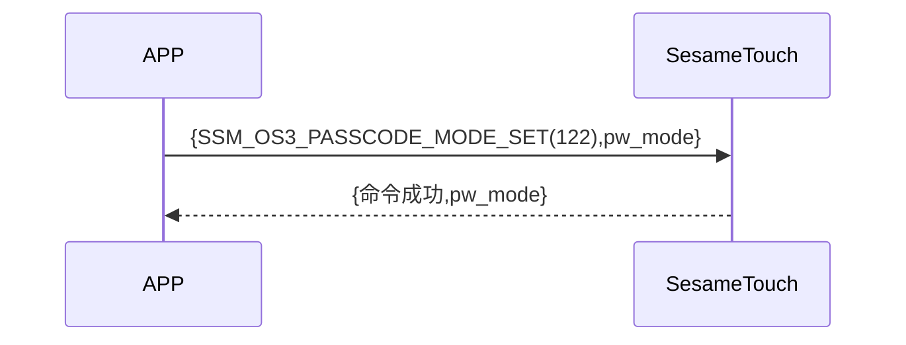

# 130 Password Mode Set(Password Mode Set)

The phone sends a new command to get whether the ssm_touch is currently in the new or verify password mode. Sesame5 replies with the successful command and mode.

## Sequence Diagram

## Data Sent by Phone

| Byte |    1    |     0     |
| ---- | :-----: | :-------: |
| Data | pw_mode | item code |

item code : SSM_OS3_PASSCODE_MODE_SET (130)

## ssm_touch Return Content

| Byte |    4    |  3  |     2     |  1   |    0    |
| ---- | :-----: | :-: | :-------: | :--: | :-----: |
| Data | pw mode | res | item code | type | op code |

type : SSM2_OP_CODE_RESPONSE(0x07)

item code : SSM_OS3_PASSCODE_MODE_SET (130)

res : CMD_RESULT_SUCCESS (0x00)

## pw mode

0x00->Verify mode

0x01->New mode

## iOS, Android, ESP32 Example

 

