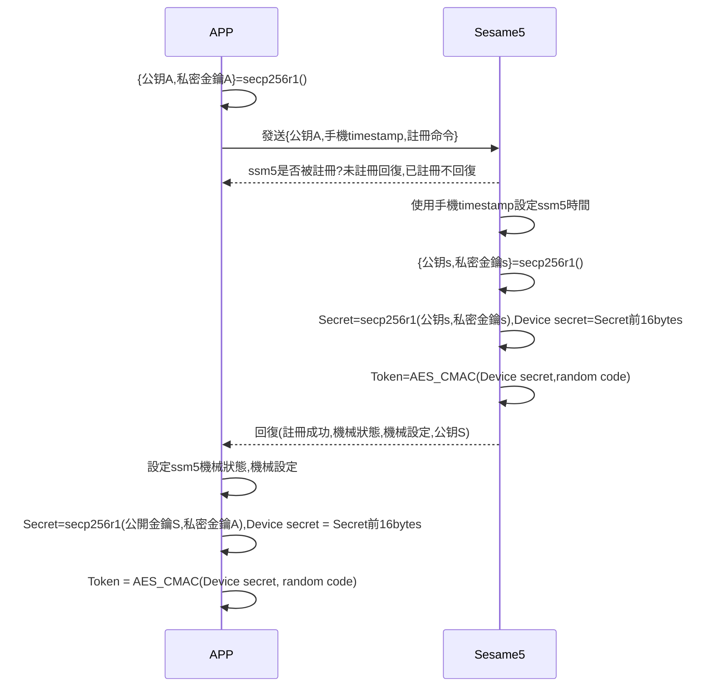
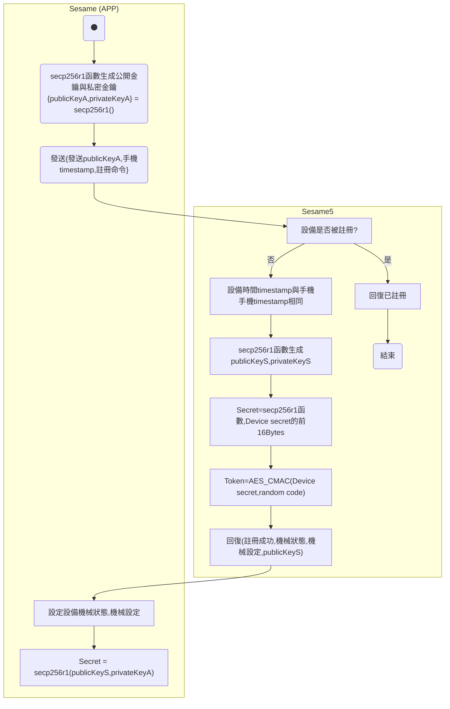

# 1 Register (register device)

Registering is the action of pairing the APP with Sesame5. Only paired APPs can control the Sesame5.

Details regarding the encryption implementation can be found in `security layer`.

## Sequence diagram of Sesame(APP) registering with Sesame5

## Activity diagram of Sesame(APP) registering with Sesame5

## Mobile sends data

| Byte |     68 ~ 65      |   64 ~ 1   |     0     |
| ---- | :--------------: | :--------: | :-------: |
| Data | Mobile timestamp | publicKeyA | item_code |

## Sesame5 returns data (already registered)

| Byte        |             2             |         1          |     0     |
| ----------- | :-----------------------: | :----------------: | :-------: |
| Data        |            res            |     item_code      |   type    |
| Description | Command processing status | Instruction number | Push type |

type: SSM2_OP_CODE_RESPONSE (0x07)

item code: SSM2_ITEM_CODE_LOGIN (1)

res: CMD_RESULT_INVALID_ACTION (0x09)

## Sesame5 returns data (unregistered)

| Byte        |          N ~ 3          |             2             |         1          |     0     |
| ----------- | :---------------------: | :-----------------------: | :----------------: | :-------: |
| Data        |         payload         |            res            |     item_code      |   type    |
| Description | Data sent to the mobile | Command processing status | Instruction number | Push type |

type: SSM2_OP_CODE_RESPONSE (0x07)

item code: SSM2_ITEM_CODE_LOGIN (1)

res: CMD_RESULT_SUCCESS (0x00)

payload: See the table below for details

### Payload

| Byte |  76 ~ 13   |   12 ~ 7    |   6 ~ 0    |
| ---- | :--------: | :---------: | :--------: |
| Data | publicKeyS | mechSetting | mechStatus |

## iOS, Android, ESP32 example

