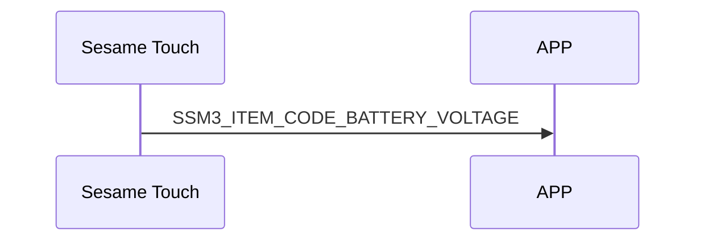

# 202. Battery Voltage

battery_data: battery voltage data.

## Structure of battery_data:

### battery_data structure of Sesame Touch

```c
#pragma pack(1)
typedef struct
{
    uint16_t light_load_voltage;
    uint16_t heavy_load_voltage;
} battery_data_t;
#pragma pack()
```

To prevent clients from requesting it too frequently, it is only sent proactively by the sesame device.

## Sequence diagram of mechStatus transfer between the phone and ssm5



## Sesame Touch push content

| Byte |     N ~ 2      |     1     |    0     |
| ---- | :------------: | :-------: | :------: |
| Data |    payload     | item_code |   type   |
| Description | Data sent to the phone | Item code | Type |

type : SSM2_OP_CODE_PUBLISH (0x08)

item code : SSM3_ITEM_CODE_BATTERY_VOLTAGE (202)

payload : see the table below

### payload

| Byte |    3 ~ 0     |
| ---- | :----------: |
| Data | battery_data |
