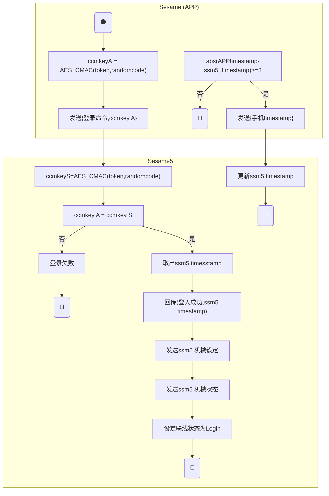
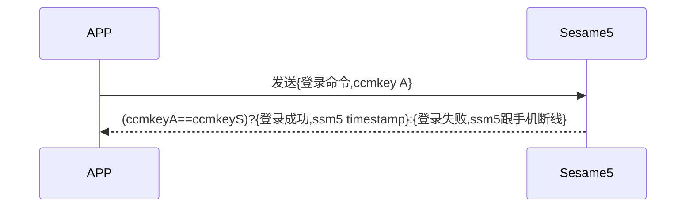

# 2 Login (Login)

Devices that have already registered with Sesame5 need to log in after connecting in order to control.

Details for the implementation of encryption can be found in the `security layer`.

## Sesame(APP) logging in to Sesame5 activity diagram

APP logs in to Sesame5 ccmKey - only the first 4 Bytes are compared.

 
## Sesame(APP) registering to Sesame5 sequence diagram

## Mobile sending out data

| Byte |  4 ~ 1   |     0     |
| ---- | :------: | :-------: |
| Data | ccmkey A | item code |

item code : SSM2_ITEM_CODE_LOGIN (2)

## Sesame5 response message

| Byte |     N ~ 3      |      2       |     1     |    0     |
| ---- | :------------: | :----------: | :-------: | :------: |
| Data |    payload     |     res      | item_code |   type   |
| Description | Data to mobile | Processing status of command  | Command number  | Type of push |

type : SSM2_OP_CODE_RESPONSE (0x07)

item code : SSM2_ITEM_CODE_LOGIN (2)

res : CMD_RESULT_SUCCESS (0x00)

payload : See the following table for details

### payload

| Byte |   3 ~ 0   |
| ---- | :-------: |
| Data | timestamp |

## iOS, Android, ESP32 examples

 