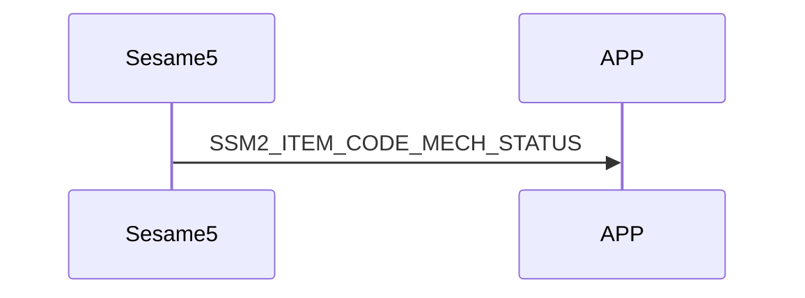

# 81 Mech Status (Mechanical Status)

MechStatus stores the status of each hardware in sesame5.

## Structure of mechStatus:

```c
#pragma pack(1)
typedef struct mech_status_s {
    uint16_t battery;
    int16_t target;                     // The place the motor wants to reach
    int16_t position;                   // The latest angle synced by the sensor
    uint8_t is_clutch_failed: 1;        // Whether the electromagnet has succeeded (not used)
    uint8_t is_lock_range: 1;           // In the lock position
    uint8_t is_unlock_range: 1;         // In the unlock position
    uint8_t is_critical: 1;             // Open and close lock time exceeded, motor stops
    uint8_t is_stop: 1;                 // The angle of the handle does not change
    uint8_t is_low_battery: 1;          // Low battery (<5V)
    uint8_t is_clockwise: 1;            // Direction of motor rotation
} mech_status_t;
#pragma pack()
```

To prevent clients from frequently requesting the mechanical status from sesame5, the mechanical status can only be sent proactively by sesame5 when there is a change.

## Sequence diagram of mechStatus interaction between mobile and ssm5 



## Contents of ssm5 push

| Byte |     N ~ 2      |     1     |    0     |
| ---- | :------------: | :-------: | :------: |
| Data |    payload     | item_code |   type   |
| Description | Data sent to the phone | Command number  | Push Type |

type : SSM2_OP_CODE_PUBLISH (0x08)

item code : SSM2_ITEM_CODE_INITIAL (81)

payload : See the following table for details

### payload

| Byte |   6 ~ 0    |
| ---- | :--------: |
| Data | mechStatus |

## mech status

| Byte |     6      |  5 ~ 4   | 3 ~ 2  |  1 ~ 0  |
| :--: | :--------: | :------: | :----: | :-----: |
| Data | other data | position | target | battery |

## other data

| Bit  |  7   |      6       |       5        |    4    |      3      |        2        |       1       |        0         |
| :--: | :--: | :----------: | :------------: | :-----: | :---------: | :-------------: | :-----------: | :--------------: |
| Data | NULL | is_clockwise | is_low_battery | is_stop | is_critical | is_unlock_range | is_lock_range | is_clutch_failed |

## iOS, Android, ESP32 examples

