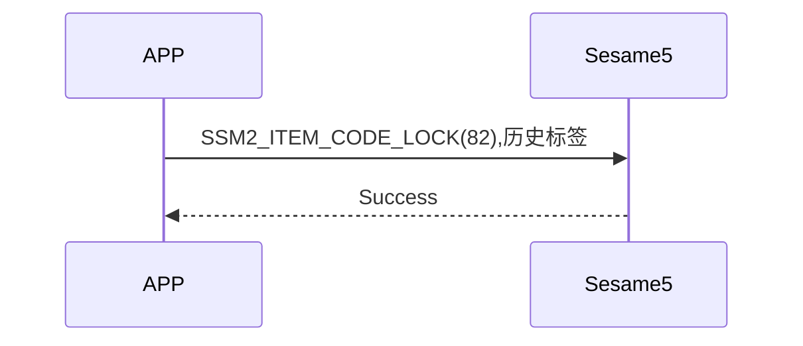

# 82. Lock (Lock)

The mobile phone sends a lock command and a history tag, and the mobile phone returns a successful command, creates a lock history and locks.

## Sequence Diagram



## Mobile phone sends data

| Byte |  7 ~ 1   |     0     |
| ---- | :------: | :-------: |
| Data | History Tag | Item code |

Item code : SSM2_ITEM_CODE_LOCK (82)

History tag : Displays the tag in the sesame5 history list

## ssm5 returns content

| Bytes |      2       |     1     |    0     |
| ----- | :----------: | :-------: | :------: |
| Data  |     res      | item_code |   type   |
| Description  | Command Processing Status | Instruction Number | Push Type |

Type : SSM2_OP_CODE_RESPONSE (0x07)

Item code : SSM2_ITEM_CODE_LOCK (82)

Res : CMD_RESULT_SUCCESS (0x00)

## iOS, Android, ESP32 examples

### Android Example

```kotlin
    override fun lock(historytag: ByteArray?, result: CHResult<CHEmpty>) {
      if (deviceStatus.value == CHDeviceLoginStatus.UnLogin && isConnectedByWM2) {
          CHAccountManager.cmdSesame(SesameItemCode.lock, this, sesame2KeyData!!.hisTagC(historytag), result)
      } else {
          if (checkBle(result)) return
//        L.d("hcia", "[ss5][lock] historyTag:" + sesame2KeyData!!.createHistagV2(historyTag).toHexString())
          sendCommand(SesameOS3Payload(SesameItemCode.lock.value, sesame2KeyData!!.createHistagV2(historytag)), DeviceSegmentType.cipher) { res ->
              if (res.cmdResultCode == SesameResultCode.success.value) {
                  result.invoke(Result.success(CHResultState.CHResultStateBLE(CHEmpty())))
              } else {
                  result.invoke(Result.failure(NSError(res.cmdResultCode.toString(), "CBCentralManager", res.cmdResultCode.toInt())))
              }
          }
      }

  }
```

### iOS Example

```swift
    public func lock(historytag: Data?, result: @escaping (CHResult<CHEmpty>))  {
      if deviceShadowStatus != nil,
         deviceStatus.loginStatus == .unlogined {
          CHIoTManager.shared.sendCommandToWM2(.lock, self) { _ in
              result(.success(CHResultStateNetworks(input: CHEmpty())))
          }
          return
      }
      if (self.checkBle(result)) { return }
      let hisTag = Data.createOS2Histag(historytag ?? self.sesame2KeyData?.historyTag)

      sendCommand(.init(.lock,hisTag)) { responsePayload in
          if responsePayload.cmdResultCode == .success {
              result(.success(CHResultStateBLE(input: CHEmpty())))
          } else {
              result(.failure(self.errorFromResultCode(responsePayload.cmdResultCode)))
          }
      }
  }
```

### ESP Example

```c
void ssm_lock(uint8_t * tag, uint8_t tag_length) {
      // ESP_LOGI(TAG, "[ssm][ssm_lock][%s]", SSM_STATUS_STR(p_ssms_env->ssm.device_status));
      sesame * ssm = &p_ssms_env->ssm;
      if (ssm->device_status >= SSM_LOGGIN) {
          if (tag_length == 0) {
              tag = tag_esp32;
              tag_length = sizeof(tag_esp32);
          }
          ssm->b_buf[0] = SSM_ITEM_CODE_LOCK;
          ssm->b_buf[1] = tag_length;
          ssm->c_offset = tag_length + 2;
          memcpy(ssm->b_buf + 2, tag, tag_length);
          talk_to_ssm(ssm, SSM_SEG_PARSING_TYPE_CIPHERTEXT);
      }
  }
```
