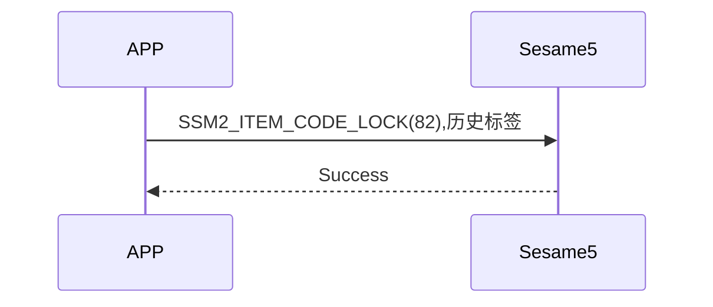

# 82 Lock (Lock)

The mobile phone sends a lock command and a history tag, and the mobile phone returns a successful command, creates a lock history and locks.

## Sequence Diagram

## Mobile phone sends data

| Byte |  7 ~ 1   |     0     |
| ---- | :------: | :-------: |
| Data | History Tag | Item code |

Item code : SSM2_ITEM_CODE_LOCK (82)

History tag : Displays the tag in the sesame5 history list

## ssm5 returns content

| Bytes |      2       |     1     |    0     |
| ----- | :----------: | :-------: | :------: |
| Data  |     res      | item_code |   type   |
| Description  | Command Processing Status | Instruction Number | Push Type |

Type : SSM2_OP_CODE_RESPONSE (0x07)

Item code : SSM2_ITEM_CODE_LOCK (82)

Res : CMD_RESULT_SUCCESS (0x00)

## iOS, Android, ESP32 examples

