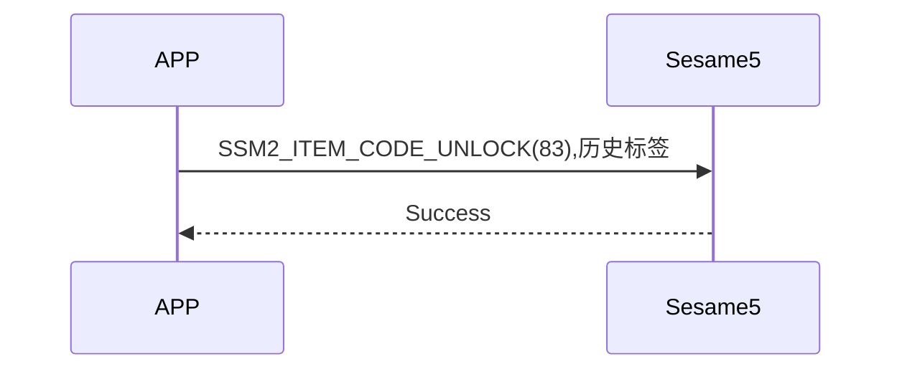

# 83 Unlock (Unlock)

The mobile phone sends the unlock command and historical tags, the phone returns the command successfully, establishes the unlock history, and unlocks.

## Sequence diagram

## Data sent by mobile phone

| Byte |  7 ~ 1   |     0     |
| ---- | :------: | :-------: |
| Data | History tags | item code |

Item code: SSM2_ITEM_CODE_UNLOCK (83)

History tag: The tag displayed in the sesame5 history list

## Contents returned by ssm5

| Byte |      2       |     1     |    0     |
| ---- | :----------: | :-------: | :------: |
| Data |     res      | item_code |   type   |
| Description| Command processing status | Instruction number | Push type|

Type: SSM2_OP_CODE_RESPONSE (0x07)

Item code: SSM2_ITEM_CODE_UNLOCK (82)

Res: CMD_RESULT_SUCCESS (0x00)

## iOS, Android, ESP32 Example

