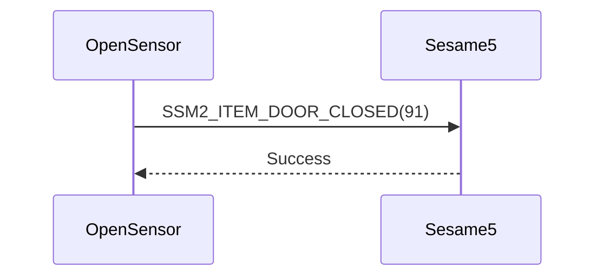

# 91. Door Closed

After Open Sensor is paired with Sesame5, Open Sensor notifies Sesame5 when it detects that the door is closed.

## Sequence diagram between Open Sensor and Sesame5

## Data sent by Open Sensor

| Byte |     0     |
|------|:---------:|
| Data | item code |

item code : SSM2_ITEM_DOOR_CLOSED (91)

## ssm5 response

| Byte |   2    |     1     |  0   |
|------|:------:|:---------:|:----:|
| Data |  res   | item_code | type |
| Description | Command result | Item code | Type |

type : SSM2_OP_CODE_RESPONSE (0x07)

item code : SSM2_ITEM_DOOR_CLOSED (91)

res : CMD_RESULT_SUCCESS (0x00)
