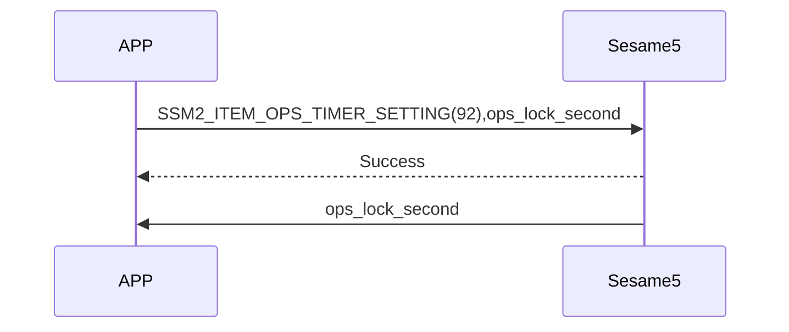
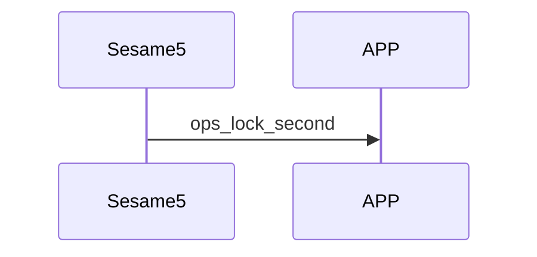

# 92. OpenSensor timer setting

Delay before OpenSensor auto-locks after the door closes

## Sequence diagram between the phone and Sesame5

The APP sets on Sesame5 the delay before auto-locking after the door closes.

Sesame5 proactively pushes the auto-lock delay after the door closes to the phone.

## Command sent by the APP

| Byte |      2 ~ 1      |     0     |
|------|:---------------:|:---------:|
| Data | ops_lock_second | item code |

item code : SSM2_ITEM_OPS_TIMER_SETTING (92)

ops_lock_second : delay before auto-locking after the door closes

## ssm5 response

| Byte |   2    |     1     |  0   |
|------|:------:|:---------:|:----:|
| Data |  res   | item_code | type |
| Description | Command result | Item code | Type |

type : SSM2_OP_CODE_RESPONSE (0x07)

item code : SSM2_ITEM_OPS_TIMER_SETTING (92)

res : CMD_RESULT_SUCCESS (0x00)

## ssm5 push content

| Byte |      3 ~ 2      |     1     |  0   |
|------|:---------------:|:---------:|:----:|
| Data | ops_lock_second | item_code | type |
| Description | Auto-lock delay after door closes | Item code | Type |

type : SSM2_OP_CODE_PUBLISH (0x08)

item code : SSM2_ITEM_OPS_TIMER_SETTING (92)

ops_lock_second : delay before auto-locking after the door closes
