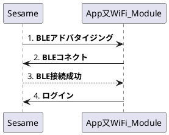
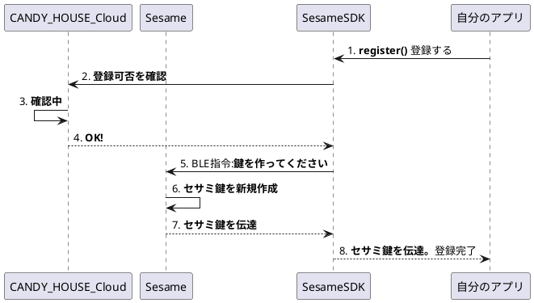
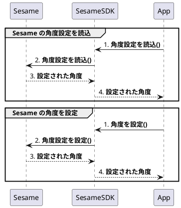
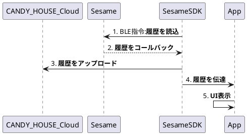
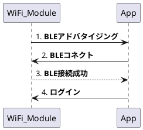
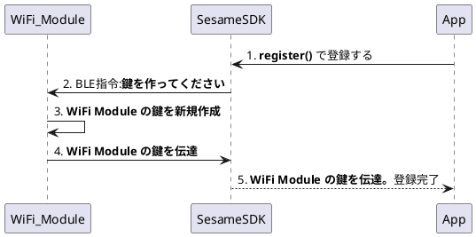
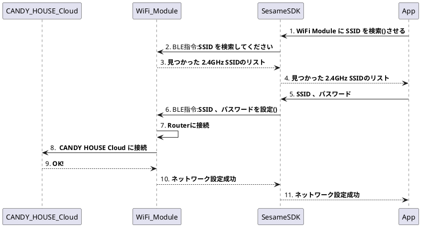
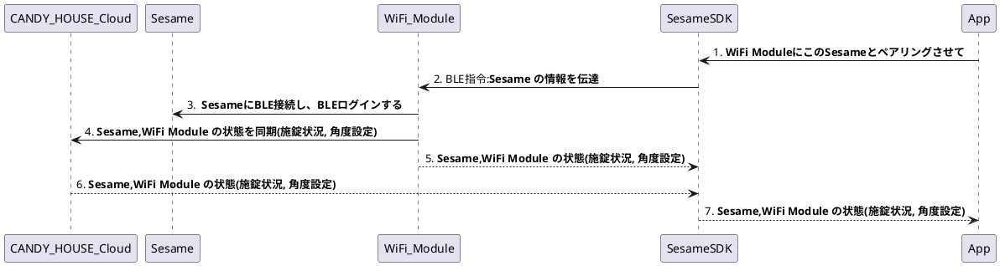
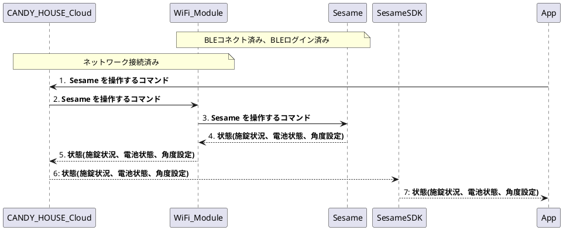
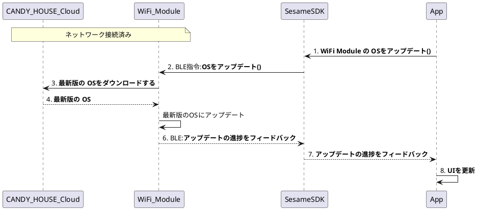

# [SesameにBLEログイン](./flow_charts.md#sesameにbleログイン)
Sesameに鍵を挿し込み成功。

# [Sesame 登録フロー](./flow_charts.md#sesame-登録フロー)
Sesame 登録/レジスター フロー

# [Sesame の角度設定](./flow_charts.md#sesame-の角度設定)

# [Sesame 状態遷移図](./flow_charts.md#sesame-状態遷移図)

**if(!isRegistered) セサミデバイスが未登録の場合の状態遷移表**

<table style="border-collapse:collapse;">
    <thead style="border-color:black;border-style:solid;border-width:1px;">
    <tr>
        <th style="border-color:black;border-style:solid;border-width:1px;padding:10px 5px;">現在状態 → 入力 ↓</th>
        <th style="border-color:black;border-style:solid;border-width:1px;padding:10px 5px;">noBleSignal</th>
        <th style="border-color:black;border-style:solid;border-width:1px;padding:10px 5px;">receivedBle</th>
        <th style="border-color:black;border-style:solid;border-width:1px;padding:10px 5px;">bleConnecting</th>
        <th style="border-color:black;border-style:solid;border-width:1px;padding:10px 5px;">waitingGatt</th>
        <th style="border-color:black;border-style:solid;border-width:1px;padding:10px 5px;">readyToRegister</th>
        <th style="border-color:black;border-style:solid;border-width:1px;padding:10px 5px;">registering</th>
        <th style="border-color:black;border-style:solid;border-width:1px;padding:10px 5px;">noSettings</th>
    </tr>
    </thead>
    <tbody>
    <tr>
        <td style="padding:10px 5px;">セサミデバイスが近くにあれば</td>
        <td style="padding:10px 5px;">receivedBle</td>
        <td />
        <td />
        <td />
        <td />
        <td />
        <td />
    </tr>
    <tr>
        <td style="padding:10px 5px;">connect()</td>
        <td />
        <td style="padding:10px 5px;">bleConnecting</td>
        <td />
        <td />
        <td />
        <td />
        <td />
    </tr>
    <tr>
        <td style="padding:10px 5px;">bleConnecting SDKが自動的に進む</td>
        <td />
        <td />
        <td style="padding:10px 5px;">waitingGatt</td>
        <td />
        <td />
        <td />
        <td />
    </tr>
    <tr>
        <td style="padding:10px 5px;">waitingGatt SDKが自動的に進む</td>
        <td />
        <td />
        <td />
        <td style="padding:10px 5px;">readyToRegister</td>
        <td />
        <td />
        <td />
    </tr>
    <tr>
        <td style="padding:10px 5px;">registerSesame2()</td>
        <td />
        <td />
        <td />
        <td />
        <td style="padding:10px 5px;">registering</td>
        <td />
        <td />
    </tr>
    <tr>
        <td style="padding:10px 5px;">registering SDKが自動的に進む</td>
        <td />
        <td />
        <td />
        <td />
        <td />
        <td style="padding:10px 5px;">noSettings</td>
        <td />
    </tr>
    <tr>
        <td style="padding:10px 5px;">configureLockPosition()</td>
        <td />
        <td />
        <td />
        <td />
        <td />
        <td />
        <td style="padding:10px 5px;">locked/unlocked/moved (isRegistered)</td>
    </tr>
    <tr>
        <td style="padding:10px 5px;">disconnect()</td>
        <td />
        <td />
        <td />
        <td />
        <td />
        <td />
        <td style="padding:10px 5px;">noBleSignal</td>
    </tr>
    </tbody>
</table>

**if(isRegistered) セサミデバイスが登録済の場合の状態遷移表**

<table style="border-collapse:collapse;">
    <thead style="border-color:black;border-style:solid;border-width:1px;">
    <tr>
        <th style="border-color:black;border-style:solid;border-width:1px;padding:10px 5px;">現在状態 → 入力 ↓</th>
        <th style="border-color:black;border-style:solid;border-width:1px;padding:10px 5px;">noBleSignal</th>
        <th style="border-color:black;border-style:solid;border-width:1px;padding:10px 5px;">receivedBle</th>
        <th style="border-color:black;border-style:solid;border-width:1px;padding:10px 5px;">bleConnecting</th>
        <th style="border-color:black;border-style:solid;border-width:1px;padding:10px 5px;">waitingGatt</th>
        <th style="border-color:black;border-style:solid;border-width:1px;padding:10px 5px;">readyToRegister</th>
        <th style="border-color:black;border-style:solid;border-width:1px;padding:10px 5px;">registering</th>
        <th style="border-color:black;border-style:solid;border-width:1px;padding:10px 5px;">noSettings</th>
    </tr>
    </thead>
    <tbody>
    <tr>
        <td style="padding:10px 5px;">セサミデバイスが近くにあれば</td>
        <td style="padding:10px 5px;">receivedBle</td>
        <td />
        <td />
        <td />
        <td />
        <td />
        <td />
    </tr>
    <tr>
        <td style="padding:10px 5px;">connect()</td>
        <td />
        <td style="padding:10px 5px;">bleConnecting</td>
        <td />
        <td />
        <td />
        <td />
        <td />
    </tr>
    <tr>
        <td style="padding:10px 5px;">bleConnecting SDKが自動的に進む</td>
        <td />
        <td />
        <td style="padding:10px 5px;">waitingGatt</td>
        <td />
        <td />
        <td />
        <td />
    </tr>
    <tr>
        <td style="padding:10px 5px;">waitingGatt SDKが自動的に進む</td>
        <td />
        <td />
        <td />
        <td style="padding:10px 5px;">readyToRegister</td>
        <td />
        <td />
        <td />
    </tr>
    <tr>
        <td style="padding:10px 5px;">registerSesame2()</td>
        <td />
        <td />
        <td />
        <td />
        <td style="padding:10px 5px;">registering</td>
        <td />
        <td />
    </tr>
    <tr>
        <td style="padding:10px 5px;">registering SDKが自動的に進む</td>
        <td />
        <td />
        <td />
        <td />
        <td />
        <td style="padding:10px 5px;">noSettings</td>
        <td />
    </tr>
    <tr>
        <td style="padding:10px 5px;">configureLockPosition()</td>
        <td />
        <td />
        <td />
        <td />
        <td />
        <td />
        <td style="padding:10px 5px;">locked/unlocked/moved (isRegistered)</td>
    </tr>
    <tr>
        <td style="padding:10px 5px;">disconnect()</td>
        <td />
        <td />
        <td />
        <td />
        <td />
        <td />
        <td style="padding:10px 5px;">noBleSignal</td>
    </tr>
    </tbody>
</table>

# [Sesame 履歴機能](./flow_charts.md#sesame-履歴機能)

# [WiFi ModuleにBLEログイン](./flow_charts.md#wifi-moduleにbleログイン)

WiFi Moduleに鍵を挿し込み成功。

# [WiFi Module 登録フロー](./flow_charts.md#wifi-module-登録フロー)

WiFi Module 登録/レジスター フロー

# [WiFi Module のRouter設定](./flow_charts.md#wifi-module-のrouter設定)

# [WiFi Module 状態遷移図](./flow_charts.md#wifi-module-状態遷移図)

# [WiFi Module と Sesame のペアリング](./flow_charts.md#wifi-module-と-sesame-のペアリング)

# [CANDY HOUSE Cloud と WiFi Module 経由で Sesame を遠隔操作](./flow_charts.md#candy-house-cloud-と-wifi-module-経由で-sesame-を遠隔操作)

# [WiFi Module の OSをアップデート](./flow_charts.md#wifi-module-の-osをアップデート)

