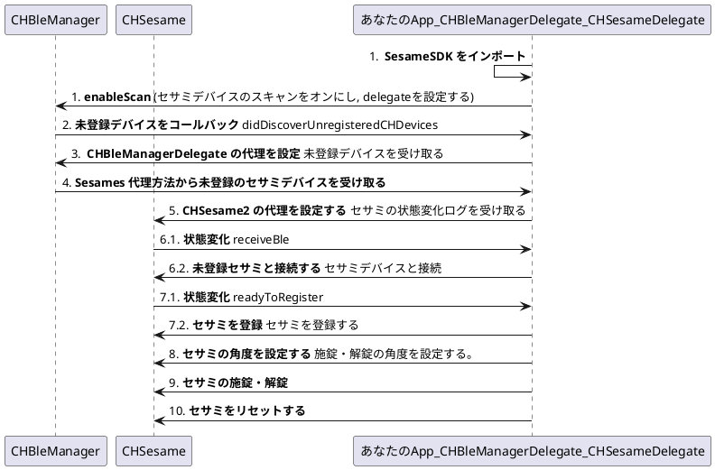

# [目的](./quick_start_ios.md#目的)

iOS 開発者向けに SesameSDK のインストールから設定までのクイックガイドです。コピペですぐに動く[サンプルコード](./quick_start_ios.md#サンプルコード)を通じて Sesame の登録・設定・操作・リセットなどができるアプリを一瞬で作りましょう。

# [インストールと設定](./quick_start_ios.md#インストールと設定)

- [CocoaPods](https://cocoapods.org/app)経由で SesameSDK をインストールします。

```swift
// Podfile
target 'SesameUI' do
  use_frameworks!
  pod 'SesameSDK', :git => 'git@github.com:CANDY-HOUSE/SesameSDK_iOS.git', :branch => 'main'
end
```

- プロジェクトの`Info.plist`にて BLE 権限説明を記載します [NSBluetoothAlwaysUsageDescription](https://developer.apple.com/documentation/bundleresources/information_property_list/nsbluetoothalwaysusagedescription)
- CANDY HOUSE から API_KEY の<a href="https://partners.candyhouse.co" target="_blank">取得</a>は開発段階の時に省略可。サンプルコードのままの API_KEY をご使用ください。

```swift
// AppDelegate.swift
import SesameSDK
func application(_ application: UIApplication, didFinishLaunchingWithOptions launchOptions: [UIApplication.LaunchOptionsKey: Any]?) -> Bool
    CHConfiguration.shared.apiKey = "your_api_key"
    CHConfiguration.shared.appGroup = "group.candyhouse.widget" // 省略可。iOS Widget(Today Extension)のためにある。
}
```

SesameSDK のインストールと設定の手順は以上です。🎉

# [サンプルコードを紹介](./quick_start_ios.md#サンプルコードを紹介)

**サンプルコードのフロー図**



**近くにある未登録のセサミを検索する**

1. SesameSDK をインポート
2. 近くにある`sesames`のスキャンをオン
3. `CHBleManagerDelegate` 代理を設定する
4. 代理方法から未登録の`sesames`を受け取る

**登録とロックの開閉**

5. `CHSesame2` の代理を設定 ([Sesame 状態図](../reference.md#chsesame2status))
6. 未登録の `sesame`と接続
7. `sesame`を登録([フロー図](../flow_charts.md#sesame-登録フロー))
8. `sesame` の角度を設定
9. `sesame` のロック開閉
10. `sesame`をリセット

# [サンプルコード](./quick_start_ios.md#サンプルコード)

```swift
import UIKit
import SesameSDK // SesameSDK をインポート

let cellIdentifier = "cell"
class ViewController: UIViewController, UITableViewDataSource, UITableViewDelegate {

    let tableView = UITableView(frame: .zero)
    var unregisteredSesames = [CHSesame2]()
    var registeredSesames = [CHSesame2]()

    override func viewDidLoad() {
        super.viewDidLoad()

        tableView.translatesAutoresizingMaskIntoConstraints = false
        view.addSubview(tableView)
        tableView.topAnchor.constraint(equalTo: view.topAnchor).isActive = true
        tableView.bottomAnchor.constraint(equalTo: view.bottomAnchor).isActive = true
        tableView.leadingAnchor.constraint(equalTo: view.leadingAnchor).isActive = true
        tableView.trailingAnchor.constraint(equalTo: view.trailingAnchor).isActive = true
        tableView.delegate = self
        tableView.dataSource = self
        tableView.register(UITableViewCell.self, forCellReuseIdentifier: cellIdentifier)

        CHBleManager.shared.enableScan() { res in } // 近くにある`sesames`のスキャンをオン
        CHBleManager.shared.delegate = self         // CHBleManagerDelegate 代理を設定する
        CHDeviceManager.shared.getCHDevices { result in  // 登録済みのセサミを取得　
            if case let .success(devices) = result {
                self.registeredSesames = devices.data.compactMap({ $0 as? CHSesame2 })
                for sesame in self.registeredSesames {
                    sesame.delegate = self
                }
                DispatchQueue.main.async {
                    self.tableView.reloadData()
                }
            }
        }
    }

    func numberOfSections(in tableView: UITableView) -> Int {
        2
    }

    func tableView(_ tableView: UITableView, numberOfRowsInSection section: Int) -> Int {
        section == 0 ? unregisteredSesames.count : registeredSesames.count
    }

    func tableView(_ tableView: UITableView, cellForRowAt indexPath: IndexPath) -> UITableViewCell {
        let cell = tableView.dequeueReusableCell(withIdentifier: cellIdentifier, for: indexPath)
        let sesame = indexPath.section == 0 ? unregisteredSesames[indexPath.row] : registeredSesames[indexPath.row]
        cell.textLabel?.text = sesame.deviceId.uuidString
        return cell
    }

    func tableView(_ tableView: UITableView, titleForHeaderInSection section: Int) -> String? {
        section == 0 ? "Register Sesame" : "My Sesame"
    }

    func tableView(_ tableView: UITableView, didSelectRowAt indexPath: IndexPath) {
        if indexPath.section == 0 {
            let sesame = unregisteredSesames[indexPath.row]
            sesame.delegate = self  // CHSesame2 の代理を設定
            sesame.connect { _ in } // 未登録の Sesame と接続
        } else {
            let sesame = registeredSesames[indexPath.row]
            sesame.toggle { _ in } // セサミのロック開閉
        }
    }

    func tableView(_ tableView: UITableView, editingStyleForRowAt indexPath: IndexPath) -> UITableViewCell.EditingStyle {
        indexPath.section == 0 ? .none : .delete
    }

    func tableView(_ tableView: UITableView, commit editingStyle: UITableViewCell.EditingStyle, forRowAt indexPath: IndexPath) {
        registeredSesames[indexPath.row].reset { _ in // Sesame リセット
            self.registeredSesames.remove(at: indexPath.row)
            DispatchQueue.main.async {
                self.tableView.deleteRows(at: [indexPath], with: .fade)
            }
        }
    }
}

extension ViewController: CHBleManagerDelegate {
    func didDiscoverUnRegisteredCHDevices(_ devices: [CHDevice]) {
        self.unregisteredSesames = devices.compactMap { $0 as? CHSesame2 } // CHBleManagerDelegate 代理方式から未登録の Sesames を受け取る
        DispatchQueue.main.async {
            self.tableView.reloadSections(IndexSet(integersIn: 0...0), with: .automatic)
        }
    }
}

extension ViewController: CHSesame2Delegate {
    func onBleDeviceStatusChanged(device: SesameLock, status: CHSesame2Status, shadowStatus: CHSesame2ShadowStatus?) {
        if status == .readyToRegister() {
            device.register { _ in // セサミを登録
                (device as! CHSesame2).configureLockPosition(lockTarget: 0, unlockTarget: 256) { _ in } // セサミの角度を設定
                self.registeredSesames.append(device as! CHSesame2)
                DispatchQueue.main.async {
                    self.tableView.reloadSections(IndexSet(integersIn: 1...1), with: .automatic)
                }
            }
        }
        if status == .receivedBle() {
            device.connect { _ in }
        }
    }
}
```

# [サンプルプロジェクト](./quick_start_ios.md#サンプルプロジェクト)

- [SesameSDK_iOS_with_DemoApp](https://github.com/CANDY-HOUSE/SesameSDK_iOS_with_DemoApp)

前へ [SesameSDK_iOS 紹介](../index.md)
次へ [Wifi-Module クイックスタート](./quick_start_wifi_module.md)
