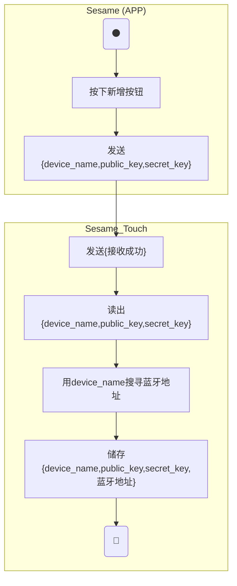
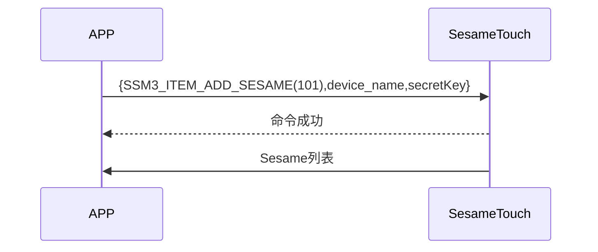

# 101. セサミ追加（新規）

携帯電話から新規命令とトークンを送信し、sesame5 が命令成功を返答し、ssm_touch が主動的にセサミのリストを携帯電話に送信します。（セサミのリストの詳細は`102_pub_ssm_key`をご覧ください）

## アクティビティ図（新規セサミ 4 を追加）

Sesame4 の Bluetooth アドレスは送信情報で解析できないため、周囲の Bluetooth デバイスをスキャンして Sesame4 の Bluetooth アドレスを見つけ出します。



## アクティビティ図（新規セサミ 5 を追加）

Sesame5 の Bluetooth アドレスは送信情報で解析できるため、周囲の Bluetooth デバイスをスキャンする必要はありません。

sessionKey = AES_CMAC(key:device_name, input:"candy")

address = sessionKey[0〜5]

address[5] |= 0xC0


## シーケンス図



## 携帯が送信するデータ

| Byte |  32 ~ 17  |   16 ~ 1    |     0     |
| ---- | :-------: | :---------: | :-------: |
| Data | secretKey | device_name | item code |

item code : SSM3_ITEM_ADD_SESAME (101)

## ssm_touch の返信内容

| Byte |      2       |     1     |       0        |
| ---- | :----------: | :-------: | :------------: |
| Data |     res      | item_code |      type      |
| 説明 | 命令処理状態 | 指令番号  | プッシュの種類 |

type : SSM2_OP_CODE_RESPONSE (0x07)

item code : SSM3_ITEM_ADD_SESAME (101)

res : CMD_RESULT_SUCCESS (0x00)

## iOS、Android、ESP32 の例

### Android の例

```kotlin
    override fun insertSesame(sesame: CHDevices, result: CHResult<CHEmpty>) {
      if (checkBle(result)) return
      if (sesame !is CHSesameLock) {// 不是锁不处理
          L.d("hcia", "[SSM BTN]isLocker?")
          result.invoke(Result.failure(CHError.BleInvalidAction.value))
          return
      }
      L.d("hcia", "送出鑰匙sesame.getKey():" + sesame.getKey())

      if (sesame is CHSesameOS3) {///ss5/5pro,bike2
          val ssm = sesame as CHDeviceUtil
          val noDashUUID = ssm.sesame2KeyData!!.deviceUUID.replace("-", "")
          val noDashUUIDDATA = noDashUUID.hexStringToByteArray()
          val ssmSecKa = ssm.sesame2KeyData!!.secretKey.hexStringToByteArray()
          sendCommand(SesameOS3Payload(SesameItemCode.ADD_SESAME.value, noDashUUIDDATA + ssmSecKa)) { ssm2ResponsePayload ->
//                L.d("hcia", "ADD_SESAME cmdResultCode:" + ssm2ResponsePayload.cmdResultCode)
              result.invoke(Result.success(CHResultState.CHResultStateBLE(CHEmpty())))
          }
      } else {/// ss3/4,bot1,bike1
          val ssm = sesame as CHDeviceUtil
          val noDashUUID = ssm.sesame2KeyData!!.deviceUUID.replace("-", "")
          val b64k = noDashUUID.hexStringToByteArray().base64Encode().replace("=", "")
          val ssmIRData = b64k.toByteArray()
          val ssmPKData = ssm.sesame2KeyData!!.sesame2PublicKey.hexStringToByteArray()
          val ssmSecKa = ssm.sesame2KeyData!!.secretKey.hexStringToByteArray()
          val allKey = ssmIRData + ssmPKData + ssmSecKa
          sendCommand(SesameOS3Payload(SesameItemCode.ADD_SESAME.value, allKey)) {
              result.invoke(Result.success(CHResultState.CHResultStateBLE(CHEmpty())))
          }
      }
  }
```

### iOS の例

```swift
     func insertSesame(_ device: CHDevice, matterProductModel: MatterProductModel, result: @escaping CHResult<CHEmpty>) {
      if (self.checkBle(result)) { return }
      let noDashUUID = device.deviceId.uuidString.replacingOccurrences(of: "-", with: "", options: [], range: nil)
      let noDashUUIDData = noDashUUID.hexStringtoData()
      let ssmSecKa = device.getKey()!.secretKey.hexStringtoData()
      let matter = UInt8(device.productModel.rawValue).data + matterProductModel.rawValue.data
      sendCommand(.init(.addSesame,noDashUUIDData + ssmSecKa + matter)) { (response) in
          result(.success(CHResultStateNetworks(input: CHEmpty())))
      }
  }
```

### ESP の例

```c
        log_info_array_ex("[main][SSM3_ITEM_ADD_SESAME]", p_param->data, p_param->length)
    talk_to_mob(p_param->conidx, SSM2_SEG_PARSING_TYPE_CIPHERTEXT, ble_tx_buf, 3);
    ssm_add_key(p_param->data, p_param->length);
    publish_ssm_keys(p_param->conidx);
```
