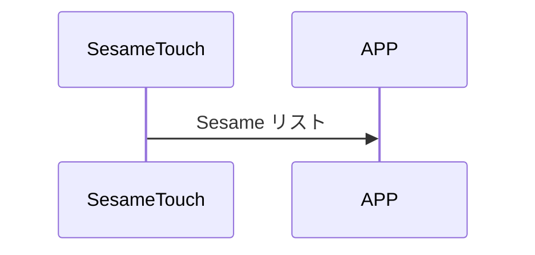

# 102. Publish Sesame Key

ssm_touch は Sesame のリストをスマホへ通知します。

## シーケンス図



## ssm_touch が通知する内容
| Byte | N ~ 2   | 1         | 0    |
|-------|:------:|:---------:|:----:|
| Data  | payload | item_code | type |
| 説明 | スマホへのデータ | 命令番号 | 通知種類 |

type : SSM2_OP_CODE_PUBLISH (0x08)

item code : SSM2_ITEM_CODE_INITIAL (102)

payload : 下表を参照

### payload
| Byte | 68          | 67 ~ 46   | 45          | 44 ~ 23   | 22          | 21 ~ 0    |
|:----:|:-----------:|:---------:|:-----------:|:---------:|:-----------:|:---------:|
| Data | ssm2_status | ssm2_name | ssm1_status | ssm1_name | ssm0_status | ssm0_name |


### Sesame Status

```c
typedef enum {
    SSM2_NOUSE = 0,
    SSM2_DISCONNECTED = 1,
    SSM2_SCANNING = 2,
    SSM2_CONNECTING = 3,
    SSM2_CONNECTED = 4,
    SSM2_LOGGIN = 5,
    SSM2_LOCKED = 6,
    SSM2_UNLOCKED = 7,
    SSM2_MOVED = 8,
} ss2_device_status;
```