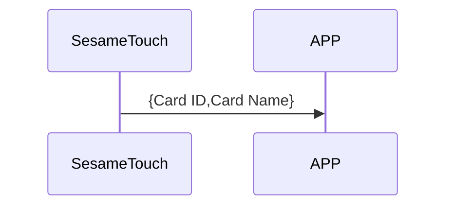
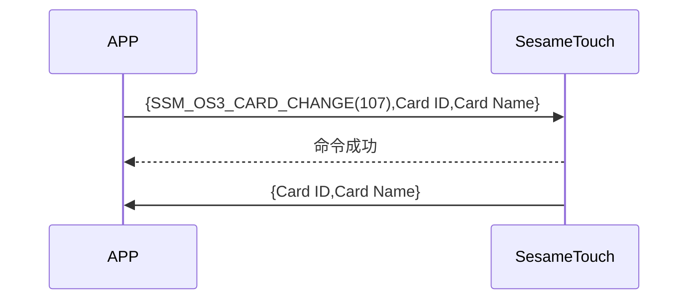

# 107. カード変更（修正）

1. ssm_touch が新しいカードを追加し、新しいカード ID と名前を携帯電話に自動的に送信します。
2. 携帯電話は id と新しい名前を ssm_touch に送信し、ssm_touch は命令の受信を成功した後でカード名を変更し、新しいカード ID と名前を携帯電話に自動的に送信します（名前が 20 バイトを超える場合、最初の 20 バイトだけを取ります）。

## シーケンス図 (新規カード追加)



## シーケンス図 (カード名の変更)



## 携帯電話からの送信データ

| バイト |  N ~ 1  |     0     |
| ------ | :-----: | :-------: |
| データ | payload | item code |

item code : SSM_OS3_CARD_CHANGE (107)

payload : 下の表を参照してください。

### payload

| バイト | (Card Name Len + Card ID Len + 1) ~ (Card ID Len + 2) | Card ID Len + 1 | Card ID Len ~ 1 |        0         |
| :----: | :---------------------------------------------------: | :-------------: | :-------------: | :--------------: |
| データ |                       カード名                        | カード名の長さ  |    カード ID    | カード ID の長さ |

#### 例

id_len = 5

name_len = 4

| バイト |  10 ~ 7  |       6        |   5 ~ 1   |        0         |
| :----: | :------: | :------------: | :-------: | :--------------: |
| データ | カード名 | カード名の長さ | カード ID | カード ID の長さ |

## ssm_touch からの返信内容

| バイト |       2        |     1     |     0      |
| ------ | :------------: | :-------: | :--------: |
| データ |      res       | item_code |    type    |
| 説明   | 命令の処理状況 | 指令番号  | 返信タイプ |

type : SSM2_OP_CODE_RESPONSE (0x07)

item code : SSM_OS3_CARD_CHANGE (107)

res : CMD_RESULT_SUCCESS (0x00)

## ssm_touch からのプッシュ通知内容

| バイト |       N ~ 2        |     1     |         0          |
| ------ | :----------------: | :-------: | :----------------: |
| データ |      payload       | item_code |        type        |
| 説明   | 携帯電話へのデータ | 指令番号  | プッシュ通知タイプ |

type : SSM2_OP_CODE_PUBLISH (0x08)

item code : SSM_OS3_CARD_CHANGE (107)

payload : 下の表を参照してください。

### payload

| バイト | (Card Name Len + Card ID Len + 1) ~ (Card ID Len + 2) | Card ID Len + 1 | Card ID Len ~ 1 |        0         |
| :----: | :---------------------------------------------------: | :-------------: | :-------------: | :--------------: |
| データ |                       カード名                        | カード名の長さ  |    カード ID    | カード ID の長さ |

#### 例

id_len = 5

name_len = 4

| バイト |  10 ~ 7  |       6        |   5 ~ 1   |        0         |
| :----: | :------: | :------------: | :-------: | :--------------: |
| データ | カード名 | カード名の長さ | カード ID | カード ID の長さ |

## iOS、Android、ESP32 の例

### Android の例

```kotlin
   override fun cardChange(ID: String, name: String, result: CHResult<CHEmpty>) {
      if (checkBle(result)) return
      sendCommand(SesameOS3Payload(SesameItemCode.SSM_OS3_CARD_CHANGE.value, byteArrayOf(ID.hexStringToByteArray().size.toByte()) + ID.hexStringToByteArray() + name.toByteArray())) { res ->
          result.invoke(Result.success(CHResultState.CHResultStateBLE(CHEmpty())))
      }
  }
```

### iOS の例

```swift
    func cardsChange(ID: String, name: String, result: @escaping (CHResult<CHEmpty>)) {
      if (self.checkBle(result)) { return }

      let idData = ID.hexStringtoData()
      let payload = Data([UInt8(idData.count)]) + idData + name.bytes
      L.d("TouchDevice",payload.toHexLog())
      sendCommand(.init(.SSM_OS3_CARD_CHANGE, payload)) { _ in
          L.d("[TouchDevice][fingerPrintsChange][ok]")
          result(.success(CHResultStateNetworks(input: CHEmpty())))
      }
  }
```

### ESP の例

```c
if (cmd_it_code == SSM2_ITEM_CODE_MECH_SETTING) {
      log_info_array_ex("mech_setting", ss5->b_buf, ss5->c_offset)
      memcpy(&ss5->mechSetting, ss5->b_buf, 6);   //mech_setting 6bytes
  }

static void ssm_set_angle(sesame *ssm) {
  if (ssm->ss2_device_status >= SSM2_LOGGIN) {
      log_info("[ss5][ss5_set_angle]")
      ssm->c_offset = 7;
      ssm->b_buf[0] = SSM2_ITEM_CODE_MECH_SETTING;
      memcpy(ssm->b_buf + 1, ssm->mechSetting, 6);
      talk_to_ssm(ssm, SSM2_SEG_PARSING_TYPE_CIPHERTEXT);
  }
}
void tell_mobile_mech_setting(mobile_app *mobile) {
  ss5_publish *ss5_pub = (ss5_publish *) ble_tx_buf;
  ss5_pub->type = SSM2_OP_CODE_PUBLISH;
  ss5_pub->it = SSM2_ITEM_CODE_MECH_SETTING;
  ss5_pub->payload.mech_setting = g_device_config.mech_setting;
//    memcpy(&ble_tx_buf[2], &g_device_config.mech_setting, sizeof(mech_setting_t));
  talk_to_mobile(mobile, SSM2_SEG_PARSING_TYPE_CIPHERTEXT, (uint8_t *) ss5_pub,
                 (sizeof(mech_setting_t) + offsetof(ss5_publish, payload)));
}
```
