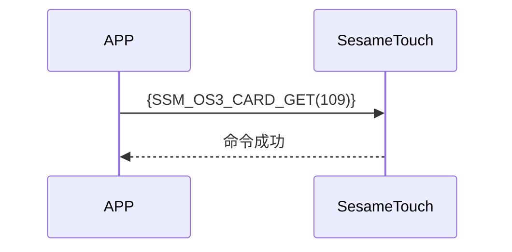

# 109. カード取得

携帯電話から ssm_touch にカード取得の指示を送り、手続成功の返信後、カードのデータを携帯電話に送信します。

## シーケンス図



## 携帯電話からのデータ送信

| バイト |       0        |
| ------ | :------------: |
| データ | アイテムコード |

アイテムコード：SSM_OS3_CARD_GET（109）

## ssm_touch からの返信

| バイト |      2       |       1        |       0        |
| ------ | :----------: | :------------: | :------------: |
| データ |     res      | アイテムコード |     タイプ     |
| 説明   | 命令処理状況 |    指示番号    | プッシュタイプ |

タイプ：SSM2_OP_CODE_RESPONSE（0x07）

アイテムコード：SSM_OS3_CARD_GET（109）

res：CMD_RESULT_SUCCESS（0x00）

## iOS、Android、ESP32 の例
 ## Androidの例

```jsx | pure
    override fun cards(result: CHResult<CHEmpty>) {
        if (checkBle(result)) return
        sendCommand(SesameOS3Payload(SesameItemCode.SSM_OS3_CARD_GET.value, byteArrayOf())) { res ->
            result.invoke(Result.success(CHResultState.CHResultStateBLE(CHEmpty())))
        }
    }
```

## iOSの例

```jsx | pure
    func cards(result: @escaping (CHResult<CHEmpty>)) {
        if (self.checkBle(result)) { return }

        sendCommand(.init(.SSM_OS3_CARD_GET)) { _ in
            result(.success(CHResultStateNetworks(input: CHEmpty())))
        }
    }
```

## ESPの例

```jsx | pure

``` 
