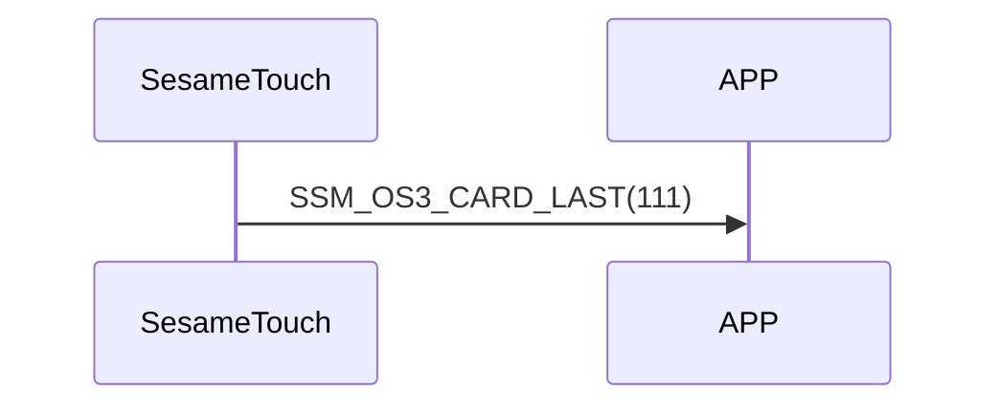

# 111. Card Last

ssm_touch はカードデータを送り終えると、Card Last をスマホへ送信し、カードデータの送信が完了したことを示します。

## シーケンス図

## ssm_touch が通知する内容
| Byte | 1         | 0    |
|-------|:---------:|:----:|
| Data  | item_code | type |
| 説明 | 命令番号 | 通知種類 |

type : SSM2_OP_CODE_PUBLISH (0x08)

item code : SSM_OS3_CARD_LAST (111)
