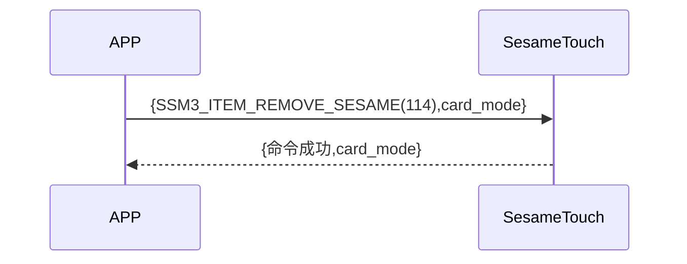

# 114. カードモード設定(モード)

携帯電話が新規指示を送信し、ssm_touchが現在新規追加モードまたはカード確認モードにあるかを取得します。sesame5は、成功した指示とそのモードを返答します。

## シーケンス図



## スマホからのデータ送信

| Byte |     1     |     0     |
| ---- | :-------: | :-------: |
| Data | card_mode | item code |

item code : SSM_OS3_CARD_MODE_SET (114)

## ssm_touch の返答内容

| Byte |     4     |  3  |     2     |  1   |    0    |
| ---- | :-------: | :-: | :-------: | :--: | :-----: |
| Data | card mode | res | item code | type | op code |

type : SSM2_OP_CODE_RESPONSE(0x07)

item code : SSM_OS3_CARD_MODE_SET (114)

res : CMD_RESULT_SUCCESS (0x00)

## card mode

0x00->確認モード

0x01->新規追加モード

## iOS、Android、ESP32 の例

### Android の例

```kotlin
    override fun cardModeSet(mode: Byte, result: CHResult<CHEmpty>) {
      if (checkBle(result)) return
      sendCommand(SesameOS3Payload(SesameItemCode.SSM_OS3_CARD_MODE_SET.value, byteArrayOf(mode))) { res ->
          result.invoke(Result.success(CHResultState.CHResultStateBLE(CHEmpty())))
      }
  }
```

### iOS の例

```swift
    func cardsModeSet(mode: UInt8, result: @escaping (CHResult<CHEmpty>)) {
      if (self.checkBle(result)) { return }

      sendCommand(.init(.SSM_OS3_CARD_MODE_SET,Data([mode]))) { _ in
          result(.success(CHResultStateNetworks(input: CHEmpty())))
      }
  }
```

### ESP の例

```c
    func cardsModeSet(mode: UInt8, result: @escaping (CHResult<CHEmpty>)) {
      if (self.checkBle(result)) { return }

      sendCommand(.init(.SSM_OS3_CARD_MODE_SET,Data([mode]))) { _ in
          result(.success(CHResultStateNetworks(input: CHEmpty())))
      }
  }
```
