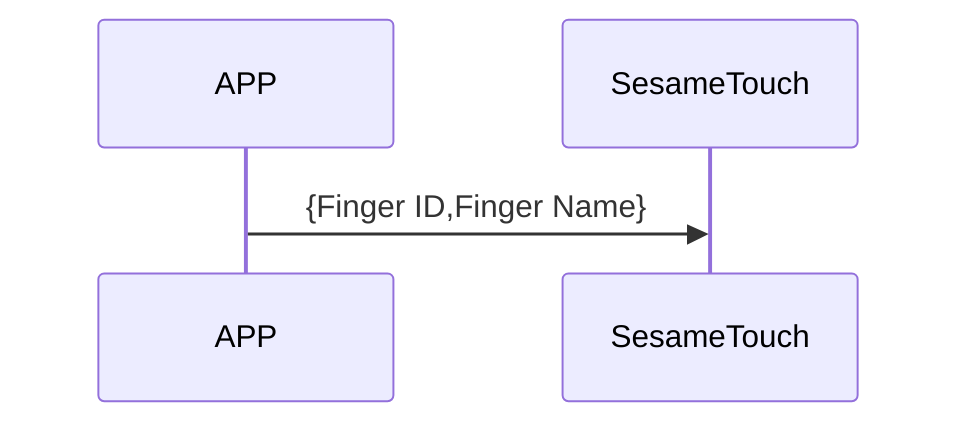
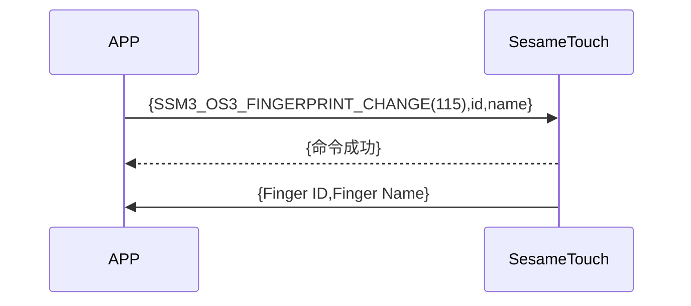

# 115\_指紋変更（指紋更新）

1. ssm_touch で新指紋を登録し、新指紋 ID と名前をスマートフォンに自動送信します。
2. スマートフォンから id と新しい名前が ssm_touch に送信され、ssm_touch はコマンド受信の成功を返信し、指紋の名前を変更します。また、新指紋の ID と名前をスマートフォンに自動送信します（名前が 20 バイトを超える場合、最初の 20 バイトだけを取得します）。

## シーケンス図（新規指紋登録）

## シーケンス図（指紋名変更）

## スマートフォンからデータ送信

| バイト |   N ~ 1    |       0        |
| ------ | :--------: | :------------: |
| データ | ペイロード | アイテムコード |

アイテムコード：SSM_OS3_FINGERPRINT_CHANGE（115）

ペイロード：以下の表を参照

### ペイロード

| バイト | (指紋名長 + 指紋 ID 長 + 1) ~ (指紋 ID 長 + 2) | 指紋 ID 長 + 1 | 指紋 ID 長 ~ 1 |     0      |
| :----: | :--------------------------------------------: | :------------: | :------------: | :--------: |
| データ |                     指紋名                     |    指紋名長    |    指紋 ID     | 指紋 ID 長 |

#### 例

id_len = 5

name_len = 4

| バイト | 10 ~ 7 |      6       |  5 ~ 1  |       0        |
| :----: | :----: | :----------: | :-----: | :------------: |
| データ | 指紋名 | 指紋名の長さ | 指紋 ID | 指紋 ID の長さ |

## ssm_touch 返信内容

| バイト |         2          |         1          |        0         |
| ------ | :----------------: | :----------------: | :--------------: |
| データ |        res         |   アイテムコード   |       type       |
| 説明   | コマンド処理の状態 | アイテムコード番号 | プッシュのタイプ |

type：SSM2_OP_CODE_RESPONSE（0x07）

アイテムコード：SSM_OS3_FINGERPRINT_CHANGE（115）

res：CMD_RESULT_SUCCESS（0x00）

## ssm_touch 推送内容

| バイト |              N ~ 2               |         1          |        0         |
| ------ | :------------------------------: | :----------------: | :--------------: |
| データ |            ペイロード            |   アイテムコード   |       type       |
| 説明   | スマートフォンに送信されるデータ | アイテムコード番号 | プッシュのタイプ |

type：SSM2_OP_CODE_PUBLISH（0x08）

アイテムコード：SSM_OS3_FINGERPRINT_CHANGE（115）

ペイロード：以下の表を参照

### ペイロード

| バイト | (指紋名長 + 指紋 ID 長 + 1) ~ (指紋 ID 長 + 2) | 指紋 ID 長 + 1 | 指紋 ID 長 ~ 1 |     0      |
| :----: | :--------------------------------------------: | :------------: | :------------: | :--------: |
| データ |                     指紋名                     |    指紋名長    |    指紋 ID     | 指紋 ID 長 |

#### 例

id_len = 5

name_len = 4

| バイト | 10 ~ 7 |      6       |  5 ~ 1  |       0        |
| :----: | :----: | :----------: | :-----: | :------------: |
| データ | 指紋名 | 指紋名の長さ | 指紋 ID | 指紋 ID の長さ |

## iOS、Android、ESP32 例

