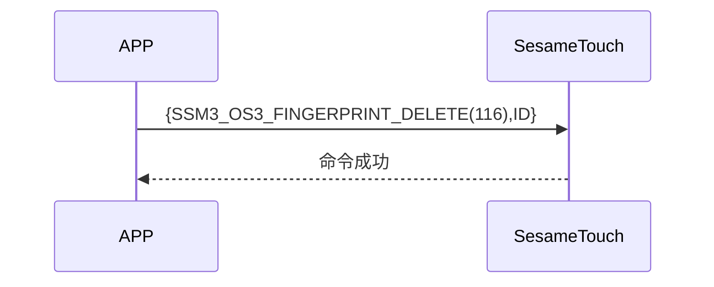

# 116. 指紋削除

スマートフォンから削除する指紋 ID を送信し、ssm_touch が成功メッセージを返し、指定した指紋を削除します。

## シーケンス図



## スマートフォン送信データ

| バイト |     1     |     0     |
| ------ | :-------: | :-------: |
| データ | finger_id | item code |

item code : SSM_OS3_FINGERPRINT_DELETE (116)

finger_id : 削除する指紋 ID

## ssm_touch 戻り値

| バイト |      2       |     1     |    0     |
| ------ | :----------: | :-------: | :------: |
| データ |     res      | item_code |   type   |
| 説明   | 命令処理状態 | 指令番号  | 送信種別 |

type : SSM2_OP_CODE_RESPONSE (0x07)

item code : SSM_OS3_FINGERPRINT_DELETE (115)

res : CMD_RESULT_SUCCESS (0x00)

## iOS、Android、ESP32 例示

### Android の例

```kotlin
    override fun cardModeGet(result: CHResult<Byte>) {
      if (checkBle(result)) return
      sendCommand(SesameOS3Payload(SesameItemCode.SSM_OS3_CARD_MODE_GET.value, byteArrayOf())) { res ->
          result.invoke(Result.success(CHResultState.CHResultStateBLE(res.payload[0])))
      }
  }
```

### iOS の例

```swift
    func fingerPrintDelete(ID: String, result: @escaping (CHResult<CHEmpty>)) {
      if (self.checkBle(result)) { return }
      sendCommand(.init(.SSM_OS3_FINGERPRINT_DELETE,ID.hexStringtoData())) { _ in
          result(.success(CHResultStateNetworks(input: CHEmpty())))
      }
  }
```

### ESP の例

```c
    func fingerPrintDelete(ID: String, result: @escaping (CHResult<CHEmpty>)) {
      if (self.checkBle(result)) { return }
      sendCommand(.init(.SSM_OS3_FINGERPRINT_DELETE,ID.hexStringtoData())) { _ in
          result(.success(CHResultStateNetworks(input: CHEmpty())))
      }
  }
```
