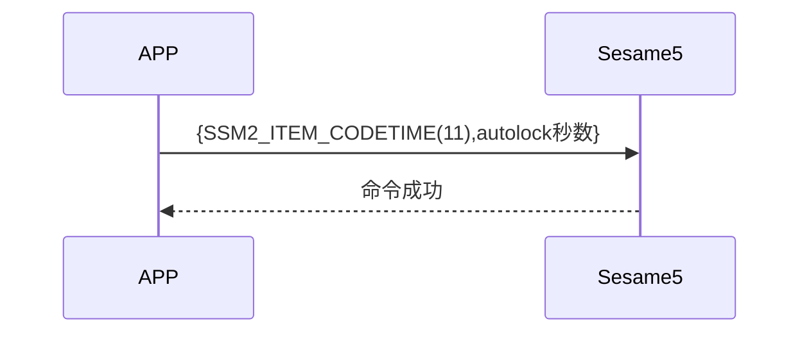

# 11. 自動ロック

スマートフォンから更新時間(item_code:11)コマンドと自動ロック秒数を送信し、ssm5 は自動ロックタイマーを開始し、成功を返します。

## シーケンス図



## スマートフォンから送信するデータ

| バイト |     2 ~ 1      |       0        |
| ------ | :------------: | :------------: |
| データ | 自動ロック秒数 | アイテムコード |

アイテムコード: SSM2_ITEM_CODE_AUTOLOCK (11)

## ssm5 からの返信

| バイト |        2         |       1        |     0      |
| ------ | :--------------: | :------------: | :--------: |
| データ |       res        | アイテムコード |   タイプ   |
| 説明   | コマンド処理状態 |    指令番号    | プッシュ型 |

タイプ: SSM2_OP_CODE_RESPONSE (0x07)

アイテムコード: SSM2_ITEM_CODE_AUTOLOCK (11)

res: CMD_RESULT_SUCCESS (0x00)

## iOS、Android、ESP32 例

### Android の例

```kotlin
override fun autolock(delay: Int, result: CHResult<Int>) {
      if (checkBle(result)) return
      sendCommand(SesameOS3Payload(SesameItemCode.autolock.value, delay.toShort().toReverseBytes()), DeviceSegmentType.cipher) { res ->
          mechSetting?.autoLockSecond = delay.toShort()
          result.invoke(Result.success(CHResultState.CHResultStateBLE(delay)))
      }
  }
```

### iOS の例

```swift
public func autolock(historytag: Data?, delay: Int, result: @escaping (CHResult<Int>))  {
      if(checkBle(result)){return}
      var autolockSet = Sesame2Autolock(Int16(delay))
      let payload = autolockSet.toData()
      return sendCommand(.init( .autolock, payload)) { (payload) in
          if payload.cmdResultCode == .success {
              result(.success(CHResultStateBLE(input: delay)))
          }
      }
  }
```

### ESP の例

```c
void autolock_sentence(void) {
      if (g_device_config.mech_setting.auto_lock_second != 0) {
          if (UNLOCKERED) {
              log_info("[autolock][go][%ds]", g_device_config.mech_setting.auto_lock_second)
                      co_timer_set(&autolock_timer, g_device_config.mech_setting.auto_lock_second * 1000,
                              TIMER_ONE_SHOT, autolock_trigger, NULL);
          }
      }
  }
```
