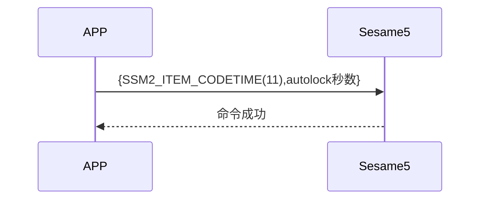

# 11 自動ロック

スマートフォンから更新時間(item_code:11)コマンドと自動ロック秒数を送信し、ssm5 は自動ロックタイマーを開始し、成功を返します。

## シーケンス図

## スマートフォンから送信するデータ

| バイト |     2 ~ 1      |       0        |
| ------ | :------------: | :------------: |
| データ | 自動ロック秒数 | アイテムコード |

アイテムコード: SSM2_ITEM_CODE_AUTOLOCK (11)

## ssm5 からの返信

| バイト |        2         |       1        |     0      |
| ------ | :--------------: | :------------: | :--------: |
| データ |       res        | アイテムコード |   タイプ   |
| 説明   | コマンド処理状態 |    指令番号    | プッシュ型 |

タイプ: SSM2_OP_CODE_RESPONSE (0x07)

アイテムコード: SSM2_ITEM_CODE_AUTOLOCK (11)

res: CMD_RESULT_SUCCESS (0x00)

## iOS、Android、ESP32 例

