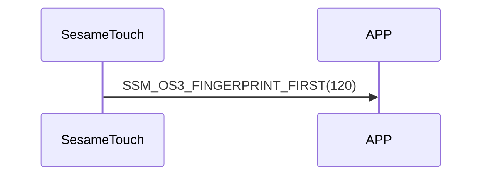

# 120. Finger Start

ssm_touch は `117_finger_get` を受信すると Finger Start コマンドを送信し、これから指紋データをスマホへ送信することを示します（`118_finger_notify` を参照）。

## シーケンス図

## ssm_touch が通知する内容
| Byte | 1         | 0    |
|-------|:---------:|:----:|
| Data  | item_code | type |
| 説明 | 命令番号 | 通知種類 |

type : SSM2_OP_CODE_PUBLISH (0x08)

item code : SSM_OS3_FINGERPRINT_FIRST (120)