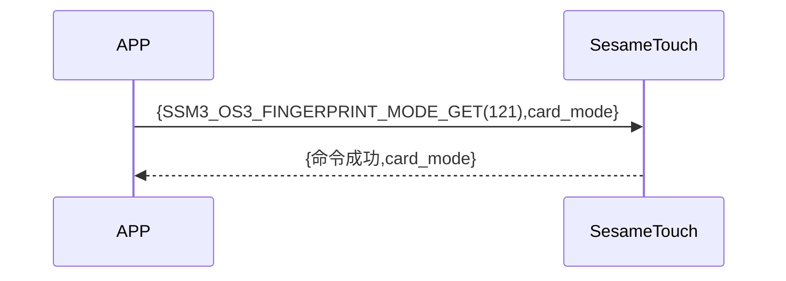

# 121 指紋モード取得

携帯電話から新規指紋追加の指示を送り、ssm_touch が現在新規追加または指紋認証モードにあるかを取得します。sesame5 は指示が成功した旨とモードを返答します。

## シーケンス図



## 携帯電話からのデータ送信

| Byte |       0        |
| ---- | :------------: |
| Data | アイテムコード |

アイテムコード : SSM_OS3_FINGERPRINT_MODE_GET (121)

## ssm_touch からの返信内容

| Byte |     4      |  3  |       2        |  1   |    0    |
| ---- | :--------: | :-: | :------------: | :--: | :-----: |
| Data | 指紋モード | res | アイテムコード | type | op code |

type : SSM2_OP_CODE_RESPONSE(0x07)

アイテムコード : SSM_OS3_FINGERPRINT_MODE_GET (121)

res : CMD_RESULT_SUCCESS (0x00)

### 指紋モード

0x00->認証モード

0x01->新規追加モード

## iOS、Android、ESP32 のサンプル
 ## Androidのサンプル

```jsx | pure
    override fun fingerPrintModeGet(result: CHResult<Byte>) {
        if (checkBle(result)) return
        sendCommand(SesameOS3Payload(SesameItemCode.SSM_OS3_FINGERPRINT_MODE_GET.value, byteArrayOf())) { res ->
            result.invoke(Result.success(CHResultState.CHResultStateBLE(res.payload[0])))
        }
    }
```

## iOSのサンプル

```jsx | pure
    func fingerPrintModeGet(result: @escaping (CHResult<UInt8>)) {
        if (self.checkBle(result)) { return }

        sendCommand(.init(.SSM_OS3_FINGERPRINT_MODE_GET)) { response in
            L.d("[TouchDevice][fingerPrintModeGet]",response.data[0])
            result(.success(CHResultStateNetworks(input: response.data[0])))
        }
    }
```

## ESPのサンプル

```jsx | pure

``` 
