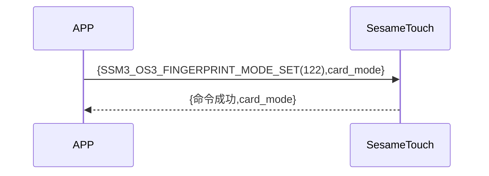

# 114 指モード設定

携帯電話は、新規指令を送信して、ssm_touch が新規モードか指紋認証モードかを取得します。sesame5 は指令成功とモードを返します。

## シーケンス図

## 携帯からのデータ送信

| バイト |    1     |     0      |
| ------ | :------: | :--------: |
| データ | 指モード | 項目コード |

項目コード：SSM_OS3_CARD_MODE_SET（114）

## ssm_touch のレスポンス内容

| バイト |    4     |  3  |     2      |  1   |       0        |
| ------ | :------: | :-: | :--------: | :--: | :------------: |
| データ | 指モード | res | 項目コード | type | コマンドコード |

タイプ：SSM2_OP_CODE_RESPONSE（0x07）

項目コード：SSM_OS3_CARD_MODE_SET（114）

res：CMD_RESULT_SUCCESS（0x00）

## 指モード

0x00->認証モード

0x01->新規モード

## iOS、Android、ESP32 のサンプル

