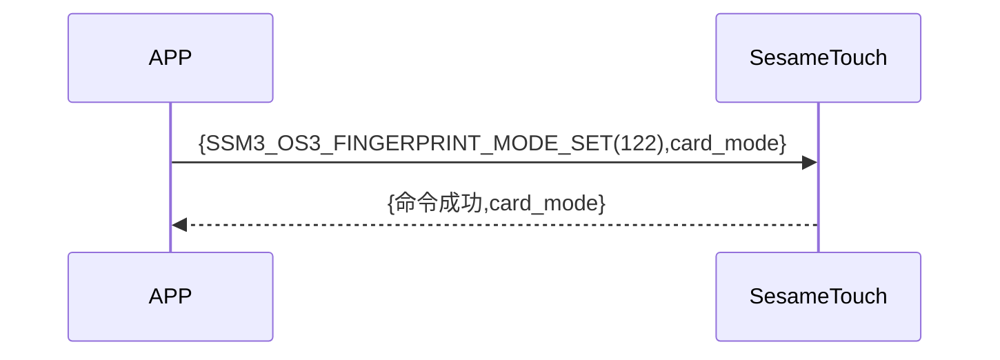

# 122. 指モード設定

携帯電話は、新規指令を送信して、ssm_touch が新規モードか指紋認証モードかを取得します。sesame5 は指令成功とモードを返します。

## シーケンス図



## 携帯からのデータ送信

| バイト |    1     |     0      |
| ------ | :------: | :--------: |
| データ | 指モード | 項目コード |

項目コード：SSM_OS3_CARD_MODE_SET（114）

## ssm_touch のレスポンス内容

| バイト |    4     |  3  |     2      |  1   |       0        |
| ------ | :------: | :-: | :--------: | :--: | :------------: |
| データ | 指モード | res | 項目コード | type | コマンドコード |

タイプ：SSM2_OP_CODE_RESPONSE（0x07）

項目コード：SSM_OS3_CARD_MODE_SET（114）

res：CMD_RESULT_SUCCESS（0x00）

## 指モード

0x00->認証モード

0x01->新規モード

## iOS、Android、ESP32 のサンプル

### Android の例

```kotlin
   override fun fingerPrintModeSet(mode: Byte, result: CHResult<CHEmpty>) {
      if (checkBle(result)) return
      sendCommand(SesameOS3Payload(SesameItemCode.SSM_OS3_FINGERPRINT_MODE_SET.value, byteArrayOf(mode))) {
          result.invoke(Result.success(CHResultState.CHResultStateBLE(CHEmpty())))
      }
  }
```

### iOS の例

```swift
    func fingerPrintModeSet(mode: UInt8, result: @escaping (CHResult<CHEmpty>)) {
      if (self.checkBle(result)) { return }

      sendCommand(.init(.SSM_OS3_FINGERPRINT_MODE_SET,Data([mode]))) { _ in
          result(.success(CHResultStateNetworks(input: CHEmpty())))
      }
  }
```

### ESP の例

```c
    func fingerPrintModeSet(mode: UInt8, result: @escaping (CHResult<CHEmpty>)) {
      if (self.checkBle(result)) { return }

      sendCommand(.init(.SSM_OS3_FINGERPRINT_MODE_SET,Data([mode]))) { _ in
          result(.success(CHResultStateNetworks(input: CHEmpty())))
      }
  }
```
