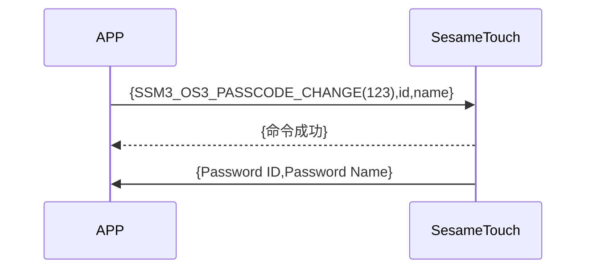

# 123 パスワード変更

1. ssm_touch が新しいパスワードを追加し、新しいパスワードの ID と名前をスマホにプッシュします。
2. スマホが id 及新名稱を ssm_touch に送信し、ssm_touch がコマンドを受け取り成功と応答した後でパスワード名を変更し、新しいパスワードの ID と名前をスマホにプッシュします（名前が 20Bytes を超える場合は、最初の 20Bytes のみ取得します）。

## シーケンス図 （新規パスワードの追加）

## シーケンス図 （パスワード名の変更）

## スマホから送信されるデータ

| Byte |  N ~ 1  |      0       |
| ---- | :-----: | :----------: |
| Data | payload | データコード |

item code : SSM_OS3_PASSCODE_CHANGE (123)

payload : 下記の表を参照ください

### payload

| Byte | (Password Name Len + Password ID Len + 1) ~ (Password ID Len + 2) | Password ID Len + 1 | Password ID Len ~ 1 |        0         |
| :--: | :---------------------------------------------------------------: | :-----------------: | :-----------------: | :--------------: |
| Data |                           パスワード名                            | パスワードの名前長  |    パスワード ID    | パスワード ID 長 |

#### 例

id_len = 5

name_len = 4

| Byte |    10 ~ 7    |         6          |     5 ~ 1     |        0         |
| :--: | :----------: | :----------------: | :-----------: | :--------------: |
| Data | パスワード名 | パスワード名の長さ | パスワード ID | パスワード ID 長 |

## ssm_touch の応答内容

| Byte |        2         |       1        |       0        |
| ---- | :--------------: | :------------: | :------------: |
| Data |       res        | アイテムコード |      type      |
| 説明 | コマンド処理状態 |  コードの指示  | プッシュタイプ |

type : SSM2_OP_CODE_RESPONSE (0x07)

item code : SSM_OS3_PASSCODE_CHANGE (123)

res : CMD_RESULT_SUCCESS (0x00)

## ssm_touch のプッシュ内容

| Byte |         N ~ 2          |       1        |       0        |
| ---- | :--------------------: | :------------: | :------------: |
| Data |        payload         | アイテムコード |      type      |
| 説明 | スマホに送信するデータ |  コードの指示  | プッシュタイプ |

type : SSM2_OP_CODE_PUBLISH (0x08)

item code : SSM_OS3_PASSCODE_CHANGE (123)

payload : 下記の表を参照ください

### payload

| Byte | (Password Name Len + Password ID Len + 1) ~ (Password ID Len + 2) |  Password ID Len + 1   | Password ID Len ~ 1 |        0         |
| :--: | :---------------------------------------------------------------: | :--------------------: | :-----------------: | :--------------: |
| Data |                           パスワード名                            | パスワードの名前の長さ |    パスワード ID    | パスワード ID 長 |

#### 例

id_len = 5

name_len = 4

| Byte |    10 ~ 7    |         6          |     5 ~ 1     |        0         |
| :--: | :----------: | :----------------: | :-----------: | :--------------: |
| Data | パスワード名 | パスワード名の長さ | パスワード ID | パスワード ID 長 |

## iOS、Android、ESP32 の例

