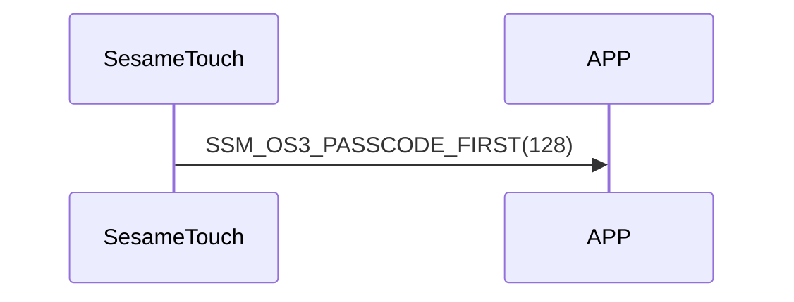

# 128. Password Start

ssm_touch は `125_pw_get` を受信すると Password Start コマンドを送信し、これからパスワードデータをスマホへ送信することを示します（`126_pw_notify` を参照）。

## シーケンス図

## ssm_touch が通知する内容
| Byte | 1         | 0    |
|-------|:---------:|:----:|
| Data  | item_code | type |
| 説明 | 命令番号 | 通知種類 |

type : SSM2_OP_CODE_PUBLISH (0x08)

item code : SSM_OS3_PASSCODE_FIRST (128)