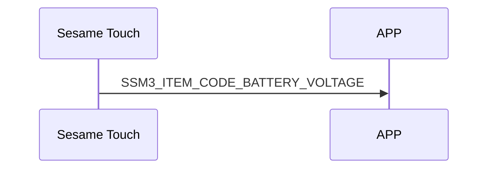

# 202. Battery Voltage（電池電圧）

battery_data：電池電圧データ。

## battery_data の構造:

### Sesame Touch の battery_data 構造

```c
#pragma pack(1)
typedef struct
{
    uint16_t light_load_voltage;
    uint16_t heavy_load_voltage;
} battery_data_t;
#pragma pack()
```

クライアントから頻繁に要求されるのを防ぐため、sesame device からのみ通知されます。

## スマホと ssm5 の mechStatus 転送シーケンス図



## Sesame Touch が通知する内容

| Byte |     N ~ 2      |     1     |    0     |
| ---- | :------------: | :-------: | :------: |
| Data |    payload     | item_code |   type   |
| 説明 | スマホへのデータ | 命令番号 | 通知種類 |

type : SSM2_OP_CODE_PUBLISH (0x08)

item code : SSM3_ITEM_CODE_BATTERY_VOLTAGE (202)

payload : 下表を参照

### payload

| Byte |    3 ~ 0     |
| ---- | :----------: |
| Data | battery_data |
