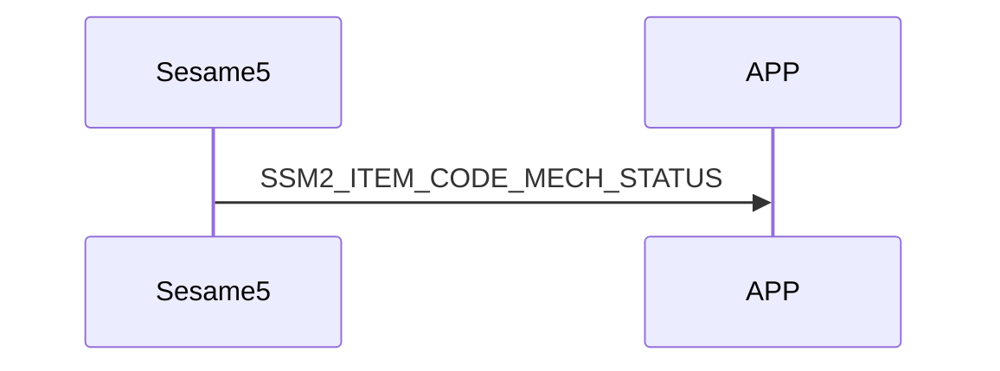

# 81 Mech Status（機械状態）

mechStatus 内には、sesame5 の各機能の状態が保存されます。

## mechStatus の構造内容 :

```c
#pragma pack(1)
typedef struct mech_status_s {
    uint16_t battery;
    int16_t target;                     // モーターの行き先
    int16_t position;                   // センサーが同期した最新の角度
    uint8_t is_clutch_failed: 1;        // 電磁クラッチの動作が成功したかどうか（使用していない）
    uint8_t is_lock_range: 1;           // 錠が閉じている位置にあるかどうか
    uint8_t is_unlock_range: 1;         // 錠が開いている位置にあるかどうか
    uint8_t is_critical: 1;             // ロック/アンロック操作がタイムアウトし、モーターが停止したかどうか
    uint8_t is_stop: 1;                 // ハンドルの角度が変わらないかどうか
    uint8_t is_low_battery: 1;          // 電池残量が低いかどうか(<5V)
    uint8_t is_clockwise: 1;            // モーターの回転方向
} mech_status_t;
#pragma pack()
```

客戶端が頻繁に sesame5 に機械状態をリクエストするのを防ぐため、機械状態が変わったときには sesame5 から積極的に送信されます。

## 携帯電話と ssm5 の mechStatus 受信交互作用のシーケンス図



## ssm5 からのプッシュ内容

| Byte |       N ~ 2        |      1       |      0       |
| ---- | :----------------: | :----------: | :----------: |
| Data |      payload       |  item_code   |     type     |
| 説明 | 携帯電話へのデータ | コマンド番号 | プッシュ種類 |

type : SSM2_OP_CODE_PUBLISH (0x08)

item code : SSM2_ITEM_CODE_INITIAL (81)

payload : 下記表を参照

### payload

| Byte |   6 ~ 0    |
| ---- | :--------: |
| Data | mechStatus |

## mech status

| Byte |     6      |  5 ~ 4   | 3 ~ 2  |  1 ~ 0  |
| :--: | :--------: | :------: | :----: | :-----: |
| Data | other data | position | target | battery |

## other data

| Bit  |  7   |      6       |       5        |    4    |      3      |        2        |       1       |        0         |
| :--: | :--: | :----------: | :------------: | :-----: | :---------: | :-------------: | :-----------: | :--------------: |
| Data | NULL | is_clockwise | is_low_battery | is_stop | is_critical | is_unlock_range | is_lock_range | is_clutch_failed |

## iOS、Android、ESP32 の例

