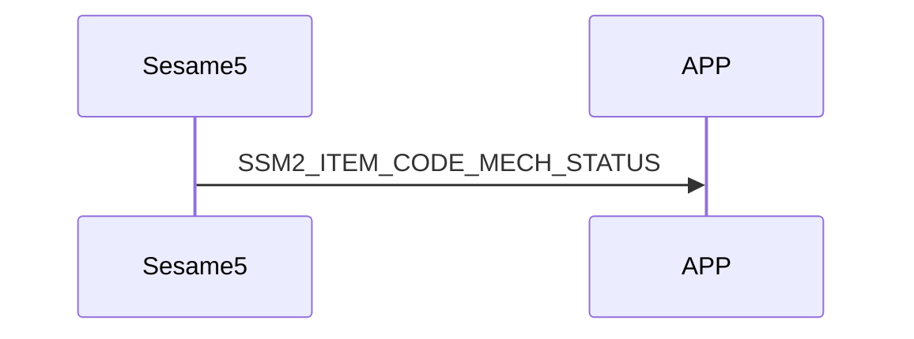

# 81. Mech Status（機械状態）

mechStatus 内には、sesame5 の各機能の状態が保存されます。

## mechStatus の構造内容 :

```c
#pragma pack(1)
typedef struct mech_status_s {
    uint16_t battery;
    int16_t target;                     // モーターの行き先
    int16_t position;                   // センサーが同期した最新の角度
    uint8_t is_clutch_failed: 1;        // 電磁クラッチの動作が成功したかどうか（使用していない）
    uint8_t is_lock_range: 1;           // 錠が閉じている位置にあるかどうか
    uint8_t is_unlock_range: 1;         // 錠が開いている位置にあるかどうか
    uint8_t is_critical: 1;             // ロック/アンロック操作がタイムアウトし、モーターが停止したかどうか
    uint8_t is_stop: 1;                 // ハンドルの角度が変わらないかどうか
    uint8_t is_low_battery: 1;          // 電池残量が低いかどうか(<5V)
    uint8_t is_clockwise: 1;            // モーターの回転方向
} mech_status_t;
#pragma pack()
```

客戶端が頻繁に sesame5 に機械状態をリクエストするのを防ぐため、機械状態が変わったときには sesame5 から積極的に送信されます。

## 携帯電話と ssm5 の mechStatus 受信交互作用のシーケンス図



## ssm5 からのプッシュ内容

| Byte |       N ~ 2        |      1       |      0       |
| ---- | :----------------: | :----------: | :----------: |
| Data |      payload       |  item_code   |     type     |
| 説明 | 携帯電話へのデータ | コマンド番号 | プッシュ種類 |

type : SSM2_OP_CODE_PUBLISH (0x08)

item code : SSM2_ITEM_CODE_INITIAL (81)

payload : 下記表を参照

### payload

| Byte |   6 ~ 0    |
| ---- | :--------: |
| Data | mechStatus |

## mech status

| Byte |     6      |  5 ~ 4   | 3 ~ 2  |  1 ~ 0  |
| :--: | :--------: | :------: | :----: | :-----: |
| Data | other data | position | target | battery |

## other data

| Bit  |  7   |      6       |       5        |    4    |      3      |        2        |       1       |        0         |
| :--: | :--: | :----------: | :------------: | :-----: | :---------: | :-------------: | :-----------: | :--------------: |
| Data | NULL | is_clockwise | is_low_battery | is_stop | is_critical | is_unlock_range | is_lock_range | is_clutch_failed |

## iOS、Android、ESP32 の例

### Android の例

```kotlin
class CHSesame5MechStatus(override val data: ByteArray) : CHSesameProtocolMechStatus {
      private val battery = bytesToShort(data[0], data[1])
      override val position: Short = bytesToShort(data[4], data[5])
      override val target: Short? = if ((bytesToShort(data[2], data[3]).toInt() == -32768)) null else bytesToShort(data[2], data[3])
      private val flags = data[6].toInt()
      override var isInLockRange: Boolean = flags and 2 > 0
      override var isBatteryCritical: Boolean = flags and 32 > 0
      override var isStop: Boolean? = flags and 16 > 0
      override fun getBatteryVoltage(): Float {
  //        L.d("hcia", "[ss5][volt]" + battery * 2f / 1000f)
          return battery * 2f / 1000f
      }
  }
```

### iOS の例

```swift
   func onGattHub3Publish(_ payload: SesameOS3PublishPayload) {
      let itemCode = payload.itemCode
      let data = payload.payload
      L.d("[Hub3][onGattHub3Publish]itemCode:",itemCode.rawValue,"data:", data.bytes)
      switch itemCode {
      case .mechStatus:
          var content = data.copyData
          guard content.count > 0 else { break }
          let isAp: Bool = (content[0...0].toInt8() & 2) > 0
          let isNet: Bool = (content[0...0].toInt8() & 4) > 0
          let isIoT: Bool = (content[0...0].toInt8() & 8) > 0
          let isAPConnecting: Bool = (content[0...0].toInt8() & 32) > 0
          let isNETConnecting: Bool = (content[0...0].toInt8() & 64) > 0
          let isIOTConnecting: Bool = content[0...0].toInt8() < 0
          mechStatus = CHWifiModule2NetworkStatus(isAPWork: isAp, isNetwork: isNet, isIoTWork: isIoT, isBindingAPWork: isAPConnecting, isConnectingNetwork: isNETConnecting, isConnectingIoT: isIOTConnecting)
     }
```

### ESP の例

```c
    case SSM_ITEM_CODE_MECH_STATUS:
    memcpy((void *) &(ssm->mech_status), ssm->b_buf, 7);
    device_status_t lockStatus = ssm->mech_status.is_lock_range ? SSM_LOCKED : (ssm->mech_status.is_unlock_range ? SSM_UNLOCKED : SSM_MOVED);
    if (ssm->device_status != lockStatus) {
        ssm->device_status = lockStatus;
        p_ssms_env->ssm_cb__(ssm); // callback: ssm_action_handle
    }
    break;

void publish_all_mechstatus(void) {
ble_tx_buf[0] = SSM2_OP_CODE_PUBLISH;
ble_tx_buf[1] = SSM2_ITEM_CODE_MECH_STATUS;
memcpy(ble_tx_buf + 2, &g_mech_status, sizeof(mech_status_t));
talk_to_all_mob(SSM2_SEG_PARSING_TYPE_CIPHERTEXT, ble_tx_buf, sizeof(mech_status_t) + 2);
}
```
