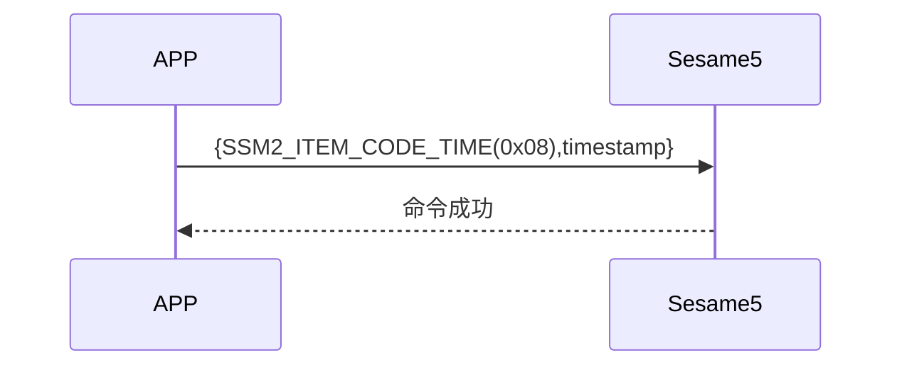

# 8. 更新時間

携帯電話が更新時間（item_code:0x08）の命令と携帯電話の timestamp を主動的に送信し、ssm5 が timestamp を更新し、更新が成功したことを返信します。

## シーケンス図



## 携帯電話からのデータ送信

| バイト |   4 ~ 1   |       0        |
| ------ | :-------: | :------------: |
| データ | timestamp | アイテムコード |

アイテムコード：SSM2_ITEM_CODE_TIME (0x08)

timestamp：携帯電話の timestamp

## ssm5 からの返事

| バイト |         2          |       1        |       0        |
| ------ | :----------------: | :------------: | :------------: |
| データ |        res         | アイテムコード |     タイプ     |
| 説明   | コマンドの処理状態 | コマンドコード | プッシュタイプ |

タイプ：SSM2_OP_CODE_RESPONSE (0x07)

アイテムコード：SSM2_ITEM_CODE_TIME (0x08)

res：CMD_RESULT_SUCCESS (0x00)

## iOS、Android、ESP32 の例
 ## Androidの例

```jsx | pure

    override fun updateTime(result: CHResult<CHEmpty>) {
        if (checkBle(result)) return
        sendCommand(SesameOS3Payload(SesameItemCode.time.value, System.currentTimeMillis().toUInt32ByteArray()), DeviceSegmentType.cipher) { res ->
            result.invoke(Result.success(CHResultState.CHResultStateBLE(CHEmpty())))
        }
    }

```

## iOSの例

```jsx | pure

    func handleLoginReceived(_ res: SesameOS3CmdResponsePayload) {
            let timestampData = Data(bytes: &timestamp,count: MemoryLayout.size(ofValue: timestamp))
            self.sendCommand(.init(.time,timestampData)) { res in
            }
        }
    }

```

## ESPの例

```jsx | pure
if (cmd_it_code == SSM2_ITEM_CODE_TIME) {
                HS_RTC->SR = request->payload.time;
                talk_to_mobile(mobile, SSM2_SEG_PARSING_TYPE_CIPHERTEXT, (uint8_t *) ss5_res,
                               offsetof(ss5_response, payload));
            }
``` 
