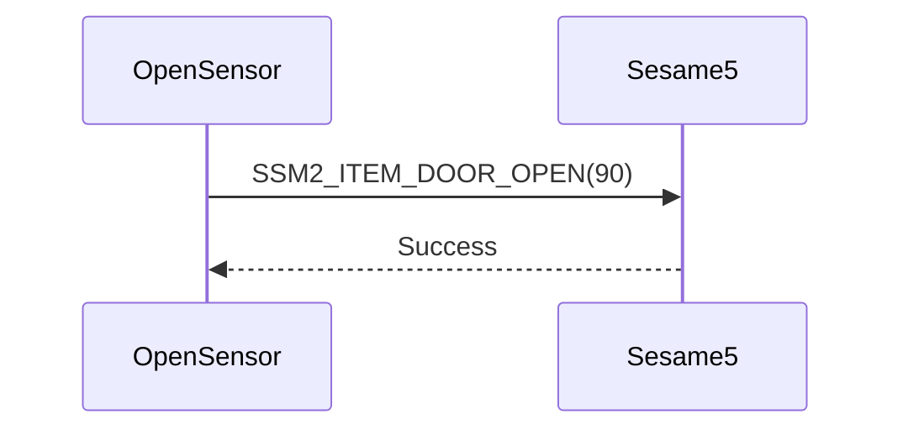

# 90. Door Open（開扉）

Open Sensor と Sesame5 をペアリングすると、Open Sensor はドアが開いたことを検知した際に Sesame5 へ通知します。

## Open Sensor と Sesame5 のシーケンス図

## Open Sensor が送信するデータ

| Byte |     0     |
|------|:---------:|
| Data | item code |

item code : SSM2_ITEM_DOOR_OPEN (90)

## ssm5 からの応答

| Byte |   2    |     1     |  0   |
|------|:------:|:---------:|:----:|
| Data |  res   | item_code | type |
| 説明 | コマンド処理結果 | 命令番号 | 通知種類 |

type : SSM2_OP_CODE_RESPONSE (0x07)

item code : SSM2_ITEM_DOOR_OPEN (90)

res : CMD_RESULT_SUCCESS (0x00)
