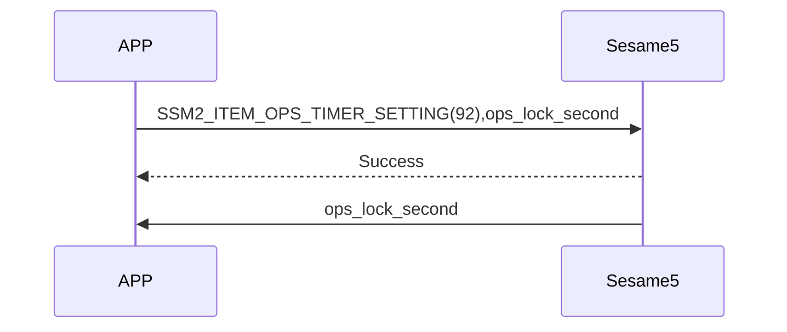
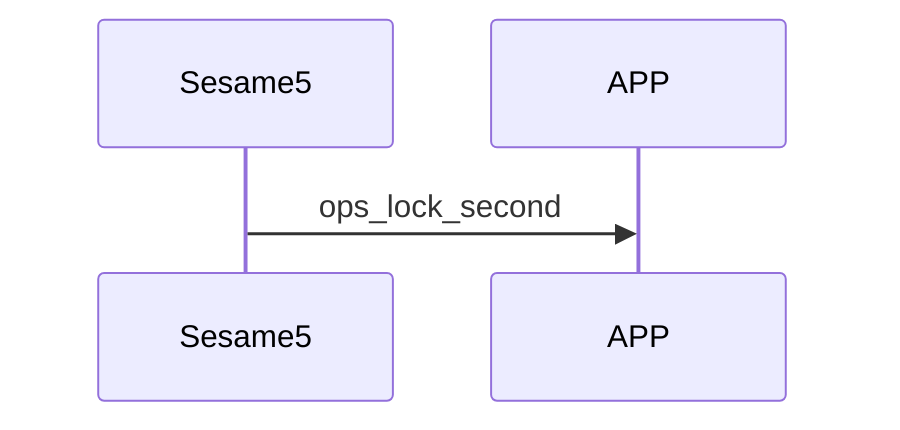

# 92. OpenSensor timer setting

OpenSensor のドア閉鎖後オートロックまでの遅延時間

## スマホと Sesame5 のシーケンス図

APP から Sesame5 に、ドア閉鎖後オートロックまでの遅延時間を設定します。

Sesame5 はドア閉鎖後オートロックまでの遅延時間をスマホへ通知します。

## APP が送信するコマンド

| Byte |      2 ~ 1      |     0     |
|------|:---------------:|:---------:|
| Data | ops_lock_second | item code |

item code : SSM2_ITEM_OPS_TIMER_SETTING (92)

ops_lock_second : ドア閉鎖後オートロックまでの遅延時間

## ssm5 からの応答

| Byte |   2    |     1     |  0   |
|------|:------:|:---------:|:----:|
| Data |  res   | item_code | type |
| 説明 | コマンド処理結果 | 命令番号 | 通知種類 |

type : SSM2_OP_CODE_RESPONSE (0x07)

item code : SSM2_ITEM_OPS_TIMER_SETTING (92)

res : CMD_RESULT_SUCCESS (0x00)

## ssm5 が通知する内容

| Byte |      3 ~ 2      |     1     |  0   |
|------|:---------------:|:---------:|:----:|
| Data | ops_lock_second | item_code | type |
| 説明 | ドア閉鎖後の施錠遅延時間 | 命令番号 | 通知種類 |

type : SSM2_OP_CODE_PUBLISH (0x08)

item code : SSM2_ITEM_OPS_TIMER_SETTING (92)

ops_lock_second : ドア閉鎖後オートロックまでの遅延時間
